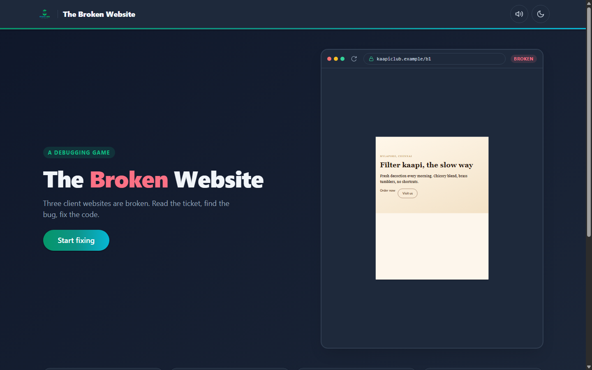
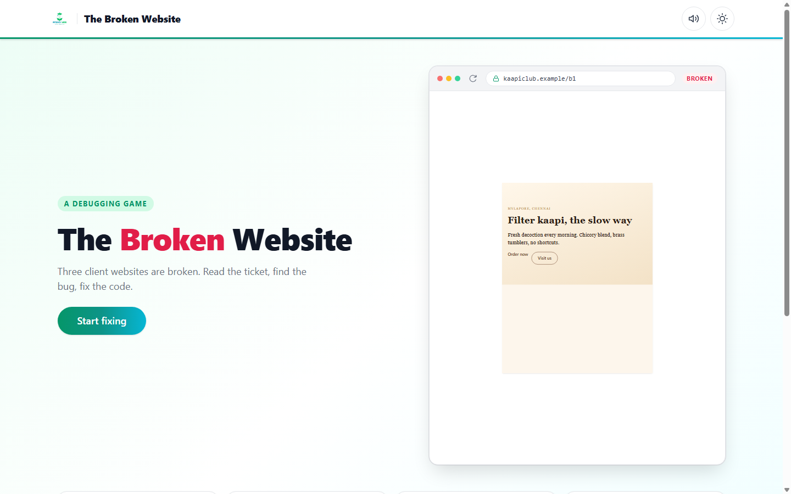
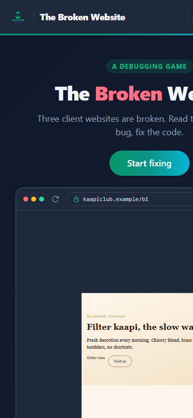
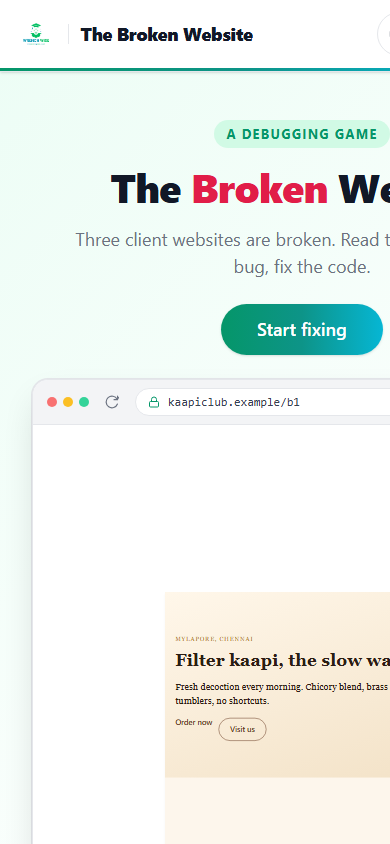
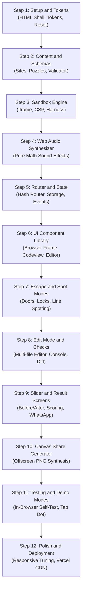

# Project Details: The Broken Website

This document gives a complete description of The Broken Website project. It explains every detail so that anyone can understand, use, explain, test, deploy, and rebuild it without prior technical knowledge.

---

## Table of Contents

1. [Quick Summary](#1-quick-summary)
2. [Purpose](#2-purpose)
3. [How to Open It](#3-how-to-open-it)
4. [Every Screen and Every Feature](#4-every-screen-and-every-feature)
5. [Every Control](#5-every-control)
6. [One Full Journey](#6-one-full-journey)
7. [The Logic](#7-the-logic)
8. [The Data](#8-the-data)
9. [Every File](#9-every-file)
10. [Tech Used](#10-tech-used)
11. [Design](#11-design)
12. [Motion and Interactions](#12-motion-and-interactions)
13. [Words on Screen](#13-words-on-screen)
14. [Settings and Saved Data](#14-settings-and-saved-data)
15. [Testing](#15-testing)
16. [Deployment](#16-deployment)
17. [Honest Status](#17-honest-status)
18. [Rebuild Guide](#18-rebuild-guide)
19. [Learning Value](#19-learning-value)
20. [Showcase](#20-showcase)
21. [Glossary](#21-glossary)

---

## 1. Quick Summary

The Broken Website is an interactive web debugging game and cyber security escape room played inside a standard web browser (index.html, lines 1 to 73). Players read real-world style customer problem reports for fictional websites, inspect HTML, CSS, and JavaScript source code, find and fix bugs, and run automated browser tests to restore the broken websites back to full health (js/main.js, init).

A bug is an error or mistake in computer code that causes a website or software program to behave incorrectly or display the wrong information. Debugging means finding that error and fixing it. The application runs entirely on the front end without any servers, databases, or build compilers (README.md, lines 13 to 16).

### Project Fact Table

| Metric | Project Value | Location in Code |
| :--- | :--- | :--- |
| Project Name | The Broken Website | index.html, line 6; config.js, line 6 |
| Current Version | 1.0.0 | config.js, line 6; content/index.js, line 19 |
| Total Files in Repository | 81 files (including documentation and screenshots) | Repository root |
| Total Source Text Files | 77 files | Repository root |
| Total Lines of Text / Code | 15,079 lines | Repository root |
| Fictional Client Websites | 4 sites (The Night Museum, Mylapore Kaapi Club, Marina Mart, Reel Seats) | content/sites.js, lines 6 to 174 |
| Gameplay Modes | 2 modes (Escape Room and Client Website Debugging) | PROJECT_BRIEF.md, lines 18 to 39 |
| Difficulty Levels | 4 paths (Escape Room, Beginner, Moderate, Expert) | content/index.js, lines 11 to 16 |
| Total Escape Rooms | 5 progressive rooms | content/escape.js, lines 7 to 532 |
| Total Debugging Puzzles | 15 puzzles (5 beginner, 5 moderate, 5 expert) | content/beginner.js; content/moderate.js; content/expert.js |
| Total Automated Check Tests | 56 behavioral checks across all puzzles | tools/verify-content.mjs, summary |
| Alternative Valid Fixes Tested | 8 alternative solutions | tools/verify-content.mjs, summary |
| Maximum Game Score | 3,000 points (puzzles) plus 500 points (escape rooms) | config.js, lines 50 to 62; js/engine/score.js, maxTotal |
| Developer Ranks | 4 ranks (Trainee, Bug Fixer, Debugger, Lead Debugger) | config.js, lines 56 to 61 |
| Live Production Web Address | https://broken-website.vercel.app/ | config.js, line 10; README.md, line 3 |
| Git Repository URL | https://github.com/Pradeep-B28/Broken_Website.git | Git origin remote |
| Active Git Branch | main | Git branch status |
| Last Git Update Date | 2026-11-02 11:36:33 +0530 | Git commit c71bfbd |
| Main Author | B Pradeep | README.md, line 7; CHANGELOG.md, lines 9 to 43 |

---

## 2. Purpose

### The Problem It Solves
Most beginners think that computer programming is mostly about typing new code on a blank screen. In the software industry, professional software engineers spend over 70 percent of their daily working time reading existing code, investigating user bug reports, debugging errors, and refactoring older systems (PROJECT_BRIEF.md, lines 41 to 42; STUDENT_EXPLAINER.md, lines 170 to 171). Traditional online coding tutorials do not teach debugging well. They ask students to memorize syntax or copy working examples without teaching them how to diagnose broken code. The Broken Website solves this training gap by placing the player directly into the role of a support developer on call who must fix real websites that are visibly broken (README.md, lines 11 to 16).

### Who It Is For
The app serves four distinct audience groups (PROJECT_BRIEF.md, lines 47 to 53):
1. Complete beginners who have never written code before. They play the Night Museum escape room where no typing is required to start.
2. College students and fresh job seekers who know basic HTML, CSS, and JavaScript. They test their knowledge in Beginner and Moderate modes.
3. Career switchers who want to experience what real day-to-day web development work feels like before enrolling in a course.
4. Experienced developers who jump straight into Expert mode to solve tricky race conditions and closures, competing for the top rank to share online.

### Why It Was Built
The project was created by Wrench Wise as an interactive educational experience and lead magnet (PROJECT_BRIEF.md, lines 45 to 46). A lead magnet is a free helpful digital product that attracts prospective students and introduces them to paid training courses. When a player completes an escape room or solves client puzzles, the application offers an immediate option to send their score and skill summary to the Wrench Wise admissions team on WhatsApp (js/links.js, salesUrl).

### Educational Program Connections
The codebase links directly to two career programs run by Wrench Wise (config.js, lines 13 to 22):
1. Primary Program: "Certification Program in AI-Powered Full Stack Development" (config.js, line 15).
2. Backup Program: "Certification Program in AI-Powered Software Engineering & DSA" (config.js, line 20). Here, DSA stands for Data Structures and Algorithms, which are systematic methods for organizing and processing data efficiently in computer software.

---

## 3. How to Open It

### The Live Link
Anyone with a web browser can open the live application at:
https://broken-website.vercel.app/

### How to Run It on a Laptop Step by Step
Running the application locally does not require installing any heavy programming libraries, npm packages, or compilers (README.md, lines 59 to 61). Because the application uses modern JavaScript modules (ES modules) and browser security sandboxes, it must be loaded through a local web server rather than by double-clicking the index.html file (README.md, lines 160 to 162).

Follow these steps to run the app on a laptop:

1. Open your terminal application (PowerShell or Command Prompt on Windows, Terminal on macOS or Linux).
2. Change into the project directory:
   ```bash
   cd "C:\Projects\Wrench-Wise\6 Broken_Website"
   ```
3. Start a local static web server using either Python or Node.js:
   - If Python is installed, run:
     ```bash
     python -m http.server 8000
     ```
   - Alternatively, if Node.js is installed, run:
     ```bash
     npx serve .
     ```
4. Open any modern web browser (such as Google Chrome, Microsoft Edge, Mozilla Firefox, or Apple Safari).
5. In the browser address bar, navigate to:
   ```
   http://localhost:8000/
   ```
6. The home screen of The Broken Website will appear on screen immediately.

### Every Special Link Option (URL Parameters)
The application includes several built-in URL query parameters. A URL query parameter is extra text added to the end of a web address starting with a question mark (`?`) that switches on special app features (js/main.js, lines 9 to 48):

| Parameter | Example Link | What It Does | Handled in Code |
| :--- | :--- | :--- | :--- |
| `?test=1` | `http://localhost:8000/?test=1` | Runs the automated 10-suite in-browser self-test harness. It checks data schemas, scoring formulas, progress cascades, WhatsApp message generators, tone rules, and storage restrictions. Disables analytics tracking automatically. | js/main.js, lines 12 to 24; js/selftest.js, runAllTests |
| `?skiplab=1` | `http://localhost:8000/?test=1&skiplab=1` | Used together with `?test=1`. Skips the long browser lab iframe tests and runs the remaining nine unit checks instantly in under one second. | js/main.js, lines 16 to 20 |
| `?labOnly=m1` | `http://localhost:8000/?test=1&labOnly=m1` | Limits the browser lab test suite to run only one specific puzzle ID or escape room ID. | js/main.js, lines 15 to 20; tools/lab.js, runLab |
| `?demo=1` | `http://localhost:8000/?demo=1&puzzle=b2` | Launches autonomous presentation demo mode. An animated floating tap dot navigates screens, inspects code, clicks lines, types fixes, and triggers checks for video recordings. | js/main.js, lines 44 to 47; js/demo.js, runDemo |
| `?puzzle=id` | `http://localhost:8000/?demo=1&puzzle=e1` | Targets a specific puzzle (such as b1 to b5, m1 to m5, e1 to e5) for demo mode. Defaults to b2 if not specified. | js/demo.js, lines 57 to 60 |
| `?room=id` | `http://localhost:8000/?demo=1&room=r4` | Targets a specific escape room (r1 to r5) for demo mode. | js/demo.js, lines 56 to 60 |
| `?theme=dark` or `?theme=light` | `http://localhost:8000/?demo=1&puzzle=e1&theme=dark` | Forces the demo mode to run in dark or light visual theme regardless of system settings. | js/demo.js, lines 50 to 53 |
| `?loop=0` | `http://localhost:8000/?demo=1&puzzle=b2&loop=0` | Disables the infinite playback loop in demo mode, stopping after one single playthrough. | js/demo.js, lines 55 to 72 |
| `?present=1` | `http://localhost:8000/?present=1` | Enables presenter mode for workshops and lectures. Adds a header badge, increases editor font size to 18px, and enables single-key hotkeys (keys 1 to 5 to jump puzzles, H for hint, S for show fix, ? for help). | js/main.js, lines 35 to 36; js/presenter.js, initPresenter |

---

## 4. Every Screen and Every Feature

The application contains eleven dedicated views and screens. The screen router switches views based on the URL hash without ever reloading the browser page (js/router.js, handleRoute).

### Screen 1: The Global Header and Navigation Bar
The header sits at the top of every screen (index.html, lines 29 to 61; styles/base.css, lines 54 to 135).
- **Brand Identity:** Displays the Wrench Wise logo image, a thin vertical separator line, and the bold text "The Broken Website". Clicking anywhere on the brand area navigates back to the home screen (index.html, lines 31 to 36).
- **Sound Toggle Button:** A circular button showing a speaker icon. Clicking it turns all sound effects on or off, saving the choice in local storage (js/sound.js, toggleMuted).
- **Theme Toggle Button:** A circular button displaying a sun icon in light mode and a moon icon in dark mode. Clicking it switches all colors across the entire application, updating the theme color in the browser frame (js/theme.js, toggleTheme).
- **Brand Gradient Bar:** A thin 3-pixel tall gradient line beneath the header that transitions from emerald green to dark teal to bright cyan (styles/base.css, lines 131 to 135).

### Screen 2: The Home Screen (`#/` or `#/home`)
The home screen introduces the challenge and displays the four game paths (js/screens/home.js, render).
- **Hero Headline:** Displays the eyebrow "A debugging game", the main title with "Broken" highlighted in rose red, and the subtitle explaining the premise (js/screens/home.js, lines 50 to 60).
- **Primary Call to Action Button:** If the player has not selected a path, the button says "Start fixing" and links to the level picker (`#/start`). If the player already started, the button says "Continue" and jumps directly to their next unsolved puzzle or room (js/screens/home.js, lines 63 to 86).
- **Interactive Hero Browser Frame:** A desktop browser mockup running a live sandboxed preview of Mylapore Kaapi Club puzzle b1. Every 7 seconds, the preview glitches, sweeps down with a cyan and green laser band to display the fixed page, holds the fixed page for 3 seconds, and then reverts to broken (js/screens/home.js, lines 104 to 127).
- **Result Link:** When at least one puzzle or escape room has been completed, a secondary link reading "See my result" appears below the start button (js/screens/home.js, lines 94 to 101).
- **Four Level Cards Grid:** Displays one card for each game mode (The Night Museum, Mylapore Kaapi Club, Marina Mart, Reel Seats). Each card shows the site name, subtitle, current solved count, score points, and an active "Your level" badge if selected (js/screens/home.js, lines 133 to 219).
- **How It Works Section:** Three numbered cards detailing the workflow: Step 1 ("Read the client's ticket"), Step 2 ("Find what breaks the page"), and Step 3 ("Fix it and run the checks") (js/screens/home.js, lines 220 to 253).

### Screen 3: The Level Picker Screen (`#/start`)
The picker asks players about their coding background to direct them to the most suitable level (js/screens/picker.js, render).
- **Title Question:** "How much code have you written?" (js/copy.js, line 21).
- **Option 1 ("Never"):** "I've never written code" with subtitle "Escape the hacked museum. No coding needed." Clicking sends the player to `#/escape` (js/screens/picker.js, lines 38 to 49).
- **Option 2 ("Little"):** "I know a little HTML or CSS" with subtitle "Beginner: spot the bug, pick the fix." Clicking sends the player to `#/level/beginner` (js/screens/picker.js, lines 50 to 61).
- **Option 3 ("Some"):** "I've built small projects" with subtitle "Moderate: fix real code." Clicking sends the player to `#/level/moderate` (js/screens/picker.js, lines 62 to 73).
- **Option 4 ("Lots"):** "I code regularly" with subtitle "Expert: race conditions, closures and worse." Clicking sends the player to `#/level/expert` (js/screens/picker.js, lines 74 to 85).
- **Reassurance Note:** Displays "You can switch anytime." at the bottom (js/screens/picker.js, lines 132 to 135).

### Screen 4: The Escape Room Intro Screen (`#/escape`)
A cinematic dark terminal presenting the fictional story of The Night Museum (js/screens/escape.js, render).
- **Simulated Browser Bar:** Shows the locked address `nightmuseum.example/locked` and the warning status "Connection lost" (js/screens/escape.js, lines 51 to 58).
- **Glitch Override Terminal:** Features a glowing green header reading "GLITCH // OVERRIDE" followed by a dynamic typewriter animation typing out the introductory story character by character at 22 milliseconds per character (js/screens/escape.js, lines 68 to 94).
- **Five Room Indicator Dots:** Five circular dots indicating progress through rooms 1 to 5 (js/screens/escape.js, lines 96 to 107).
- **Best Time Display:** If the player has previously escaped, shows "Your best time: [time]" (js/screens/escape.js, lines 110 to 115).
- **Enter Museum Button:** Initializes the escape session timer in local storage and loads room 1 at `#/room/r1` (js/screens/escape.js, lines 118 to 130).

### Screen 5: The Escape Room Play Screen (`#/room/:id`)
The gameplay screen for solving escape rooms 1 to 5 (js/screens/room.js, render).
- **Top Breadcrumb and Clock:** Shows "Room N of 5, [Title]", a live countdown clock ticking every second, a back link to `#/escape`, and a "Change level" link to `#/start` (js/screens/room.js, lines 86 to 108).
- **Phone vs Laptop Layout:** On mobile screens (under 768px), a two-button segmented switcher lets the player toggle between "Room" view and "Code" view. On laptops, both views sit side by side (js/screens/room.js, lines 111 to 120).
- **Story and Objective Card:** Displays Glitch's note and the goal explaining what passcode must be found (js/screens/room.js, lines 135 to 155).
- **Three-Tier Hint Drawer:** A collapsible card offering up to three hints. Each hint costs 20 points from the room's maximum 100 points (js/screens/room.js, lines 157 to 169).
- **Live Sandboxed Museum Preview:** An iframe displaying the museum room. In room 4, pressing the repaired button starts a countdown timer on the readout screen; in room 5, a clock counts down to open the exit door (content/escape.js, lines 351 to 493).
- **Read-Only Code Viewer:** Formatted code with line numbers. Tapping any line in an edit room opens the Single-Line Editor bottom sheet (js/ui/codeview.js, lines 15 to 80).
- **Single-Line Editor Bottom Sheet:** A modal sheet sliding up from the bottom of the screen. Shows the selected line number and file name, an input field with the line's code, an "Apply" button, an "Undo" button, a "Reset room" button, and a "Skip this room" button (js/ui/lineEditor.js, lines 12 to 95).
- **Virtual Keypad Lock:** A dark digital lock displaying an input field, a keypad matching the room's format (letters, digits, or mixed), and an "Unlock" button. Entering a correct code opens the doors. Entering an incorrect code shakes the lock. Entering a decoy code displays an explanation from Glitch (js/ui/lock.js, lines 15 to 98).
- **Sliding Blast Doors Animation:** Two dark metal blast doors slide apart across the screen with a low mechanical thunk sound when unlocked (js/ui/doors.js, lines 14 to 68).
- **Room Solved Card:** Displays "Room N escaped", points earned, star rating, an educational explanation card ("What you just did", "Why it happens", "Pro tip"), and a "Next room" button (js/ui/doors.js, lines 70 to 134).

### Screen 6: The Escaped Finish Screen (`#/escaped`)
Celebrates completing all five rooms of The Night Museum (js/screens/escaped.js, render).
- **Hero Time Display:** Displays the total escape time formatted in huge numbers (such as `12:40`) alongside total score (out of 500 points) and five room cards with stars earned (js/screens/escaped.js, lines 40 to 83).
- **Educational Transition Card:** Congratulates the player: "You just edited a website's code to escape. Developers do this every day." and offers a direct button to start Mylapore Kaapi Club ("Try the Beginner level") (js/screens/escaped.js, lines 85 to 104).
- **Program Recommendation Card:** Describes the Certification Program in AI-Powered Full Stack Development with buttons to "Talk to us on WhatsApp" (pre-filled with escape time and answers) and "See the program" (js/screens/escaped.js, lines 106 to 150).
- **Social Media Share Card:** Lets players select Status size (1080 by 1920) or Post size (1080 by 1350) and download a synthesized PNG achievement image, share via WhatsApp, or copy the link (js/screens/escaped.js, lines 152 to 157; js/share.js, createShareCard).

### Screen 7: The Level Overview Screen (`#/level/:level`)
Lists the five debugging puzzles for a chosen client website (js/screens/level.js, render).
- **Header Bar:** Breadcrumb showing the level name, a back link to Home, and a "Change level" link (js/screens/level.js, lines 39 to 52).
- **Client Site Summary Card:** Shows the client name (e.g. "Meena, owner"), the website kind ("Cafe website"), the domain address (`kaapiclub.example`), total score, and a green progress bar showing how many puzzles have been restored (js/screens/level.js, lines 54 to 76).
- **All Solved Banner:** When all 5 puzzles are solved, a banner appears with a button linking to the restored comparison screen (`#/done/:level`) (js/screens/level.js, lines 78 to 87).
- **Five Puzzle Cards Grid:** Displays five cards. Unsolved puzzles show a "Not started" tag. Solved puzzles show a "Fixed" tag, stars, and score. Locked puzzles display a lock icon with the text "Solve puzzle N first" (js/screens/level.js, lines 89 to 188).

### Screen 8: The Beginner Spot Mode Screen (`#/puzzle/b1` to `b5`)
The puzzle screen for Mylapore Kaapi Club (js/screens/spot.js, render).
- **Three-Column Layout (Laptop) / Tabs (Phone):** On laptops, the screen displays the ticket and hints on the left, the code viewer in the center, and the live preview and checks on the right. On phones, tabs allow switching between "Page", "Code", and "Checks" (js/screens/spot.js, lines 83 to 106).
- **Client Support Ticket Card:** Displays the client's complaint, the visible symptom, and an instruction to find the broken line (js/ui/ticket.js, lines 12 to 82).
- **Read-Only Code Viewer:** Displays the broken files (`index.html`, `styles.css`, `script.js`). Every code line is a clickable button (js/ui/codeview.js, lines 15 to 90).
- **Interactive Spotting Feedback:** Clicking an incorrect line highlights the line in red, plays an error blip sound, and displays "Not this line". Clicking the correct line highlights the line in green, plays a chime, displays "Found it", and opens the repair card below (js/screens/spot.js, lines 145 to 195).
- **Four Multiple-Choice Repair Cards:** Four cards appear below the code. Picking an incorrect option turns the card red and explains why that code change is wrong. Picking the correct option turns the card green, applies the fix, and runs the checks (js/screens/spot.js, lines 200 to 250).
- **Sequential Behavioral Checks:** Three checks animate sequentially with audio chimes. Once all pass, the browser preview performs a repair sweep, and the Solved Card appears (js/screens/spot.js, lines 255 to 285).

### Screen 9: The Moderate and Expert Edit Mode Screen (`#/puzzle/m1` to `m5`, `e1` to `e5`)
The full code editor screen for Marina Mart and Reel Seats (js/screens/edit.js, render).
- **Support Ticket and Acceptance Criteria:** Displays Arun's or Divya's problem description alongside a formal acceptance checklist of required behaviors (js/ui/ticket.js, lines 35 to 65).
- **Handcrafted Overlapping Code Editor:** A custom editor built with an HTML textarea placed on top of a syntax-highlighted code element. Features synchronized scrolling, line numbers, active line highlighting, two-space auto-indentation, and file tabs with dirty dot indicators (js/ui/editor.js, lines 14 to 220).
- **In-Game Console Drawer:** A collapsible drawer at the bottom of the screen that captures real-time `console.log`, `console.info`, `console.warn`, and `console.error` messages generated inside the preview iframe, playing an audio ping on the first log (js/ui/console.js, lines 12 to 125).
- **Run Checks Button:** Triggers the sandboxed check suite. Includes a 600ms cooldown to prevent double taps and a 30-second watchdog timer (js/screens/edit.js, lines 160 to 225).
- **Show the Fix (Diff Viewer):** Unlocks after three failed runs or after opening all three hints. Displays a side-by-side split diff showing exact lines added (green) and removed (red). A "Copy the fix into the editor" button copies the solution directly but reduces puzzle score to zero (js/ui/diffview.js, lines 15 to 110).
- **Solved Stamp Card:** Shows a green "Fixed" stamp, score, star rating, an educational explanation ("What was wrong", "Why it happens", "Pro tip"), and navigation buttons (js/ui/solved.js, lines 12 to 95).

### Screen 10: The Level Complete Screen (`#/done/:level`)
Celebrates completing all five puzzles of a client website (js/screens/done.js, render).
- **Celebration Stats Card:** Displays "[Site Name] is back online" with score earned, total stars, and puzzles fixed (js/screens/done.js, lines 52 to 82).
- **Before and After Comparison Slider:** An interactive slider that renders the broken website on top and the fixed website underneath. Players drag a vertical divider handle left and right to inspect the differences. A tab bar at the top lets players switch between all five puzzles. Left and right arrow keys also move the divider (js/ui/beforeAfter.js, lines 9 to 195).
- **Next Level Button:** Directs players to the next level (from Beginner to Moderate, Moderate to Expert, or Expert to Final Result) (js/screens/done.js, lines 105 to 120).

### Screen 11: The Overall Result Screen (`#/result`)
The final summary and admissions conversion screen (js/screens/result.js, render).
- **Total Points and Rank Badge:** Displays total score in large typography (up to 3,000 points) and the achieved developer rank (Trainee, Bug Fixer, Debugger, or Lead Debugger) (js/screens/result.js, lines 55 to 77).
- **Level Breakdown Grid:** Three cards detailing points and stars earned across Beginner, Moderate, and Expert levels (js/screens/result.js, lines 79 to 120).
- **Escape Room Performance Banner:** Appears if the player completed escape rooms, detailing rooms cleared and best time (js/screens/result.js, lines 43 to 52).
- **Course Recommendation Card:** Suggests the Certification Program in AI-Powered Full Stack Development with a primary WhatsApp admissions button pre-filled with the player's full score report (js/screens/result.js, lines 125 to 160).
- **Secondary Program Note:** Directs algorithms enthusiasts to the Certification Program in AI-Powered Software Engineering & DSA (js/screens/result.js, lines 162 to 170).
- **Free Live Session Card:** Displays upcoming live workshop dates and reservations when turned on in configuration (js/screens/result.js, lines 172 to 185).
- **Social Media Share Card:** Generates high-resolution share cards for Instagram/WhatsApp Status and LinkedIn/Twitter Posts (js/screens/result.js, lines 187 to 195).
- **Play Again Button:** Clears progress and returns to the home screen (js/screens/result.js, lines 197 to 205).

---

## 5. Every Control

The table below lists every interactive button, tab, input, slider, toggle, and keyboard shortcut across the entire application.

| Control Label / Name | Type | Screen Location | What It Does in Plain English | File and Function |
| :--- | :--- | :--- | :--- | :--- |
| Brand Link | Link | Header (top left) | Navigates to the home screen (`#/`). | index.html, line 31 |
| Sound Toggle | Button | Header (top right) | Toggles sound effects between muted and active. | js/sound.js, initSoundUI |
| Theme Toggle | Button | Header (top right) | Toggles light and dark visual themes. | js/theme.js, initThemeUI |
| Start fixing / Continue | Link Button | Home screen (hero) | Starts new game at picker or resumes next unsolved puzzle. | js/screens/home.js, render |
| See my result | Link | Home screen (hero) | Jumps directly to the result summary (`#/result`). | js/screens/home.js, render |
| Level Cards (4 cards) | Link Cards | Home screen (middle) | Jumps to the overview screen for that specific level. | js/screens/home.js, render |
| Experience Options (4 cards) | Buttons | Level picker (`#/start`) | Saves chosen experience path and navigates to the recommended level. | js/screens/picker.js, render |
| Enter the museum | Button | Escape intro (`#/escape`) | Starts escape timer and opens Room 1 (`#/room/r1`). | js/screens/escape.js, render |
| Room / Code Switcher | Segmented Buttons | Room screen (mobile only) | Switches view between museum room preview and code viewer. | js/screens/room.js, render |
| Hint Button | Button | Room and Puzzle screens | Opens the progressive hint drawer and reveals the next hint. | js/ui/hints.js, createHints |
| Code Line Button | Button | Room and Beginner screens | Taps a specific line of code to inspect, spot, or edit. | js/ui/codeview.js, createCodeView |
| File Tabs | Buttons | Code viewer & Editor | Switches between index.html, styles.css, and script.js. | js/ui/editor.js, createEditor |
| Reset File | Button | Editor panel (top right) | Reverts the currently active file back to its broken starting state. | js/ui/editor.js, resetActiveFile |
| Reset All | Button | Editor panel (top right) | Prompts confirmation and reverts all files back to broken starting state. | js/ui/editor.js, resetAllFiles |
| Textarea Input | Text Input | Editor panel (center) | Allows typing custom code edits with 2-space tab indentations. | js/ui/editor.js, createEditor |
| Virtual Keypad Keys | Buttons | Room screen (lock card) | Enters digits or letters into the escape room lock display. | js/ui/lock.js, createLock |
| Keypad Clear (C) | Button | Room screen (lock card) | Erases the typed code from the lock display. | js/ui/lock.js, createLock |
| Keypad Unlock | Button | Room screen (lock card) | Submits the entered code to test if it opens the room. | js/ui/lock.js, checkCodeAction |
| Line Editor Input | Text Input | Room line editor sheet | Edits a single targeted line of code in an escape room. | js/ui/lineEditor.js, createLineEditor |
| Apply (Line Editor) | Button | Room line editor sheet | Applies the edited line to the room and reloads the preview. | js/ui/lineEditor.js, applyChange |
| Undo (Line Editor) | Button | Room line editor sheet | Reverts the last single-line edit applied to the room. | js/ui/lineEditor.js, undoChange |
| Skip this room | Button | Room line editor sheet | Skips the room with 0 points after confirming the modal prompt. | js/ui/lineEditor.js, skipRoom |
| Multiple-Choice Cards (4) | Buttons | Beginner puzzle screen | Selects a proposed fix for the spotted broken line. | js/screens/spot.js, renderOptions |
| Run Checks | Button | Edit mode screen (top right) | Executes automated behavioral tests against the sandboxed page. | js/screens/edit.js, runChecksAction |
| Console Drawer Toggle | Button | Edit mode screen (bottom) | Expands and collapses the real-time JavaScript console output. | js/ui/console.js, createConsole |
| Clear Console | Button | Console drawer header | Clears all logged messages and error notices. | js/ui/console.js, createConsole |
| Show the Fix | Button | Edit mode screen | Unlocks after 3 failed runs; displays solution split diff. | js/screens/edit.js, revealSolution |
| Copy Fix to Editor | Button | Diff viewer panel | Copies the official solution into files, setting puzzle points to 0. | js/ui/diffview.js, createDiffView |
| Comparison Slider Handle | Draggable / Slider | Level done screen | Drags comparison divider left and right to inspect before/after. | js/ui/beforeAfter.js, createBeforeAfterSlider |
| Puzzle Comparison Tabs | Buttons | Level done screen | Changes which puzzle is shown in the before/after slider. | js/ui/beforeAfter.js, createBeforeAfterSlider |
| Share Size Pills | Segmented Buttons | Escaped & Result screens | Switches share card canvas size between Status and Post. | js/share.js, createShareCard |
| Share My Score (Image) | Button | Escaped & Result screens | Generates a high-res branded PNG and opens share sheet or downloads. | js/share.js, createShareCard |
| Send on WhatsApp | Link Button | Escaped & Result screens | Opens WhatsApp with pre-filled challenge text and site link. | js/share.js, createShareCard |
| Copy Link | Button | Escaped & Result screens | Copies the application web address to the clipboard. | js/share.js, createShareCard |
| Talk to Us on WhatsApp | Link Button | Escaped & Result screens | Opens WhatsApp chat with admissions team, sending score summary. | js/links.js, salesUrl |
| See the Program | Link Button | Escaped & Result screens | Navigates to Wrench Wise full stack program details page. | js/links.js, programUrl |
| Play Again | Button | Result screen (bottom) | Resets all progress data and redirects to home screen. | js/screens/result.js, render |
| Keys 1 to 5 | Hotkey | Presenter mode (`?present=1`)| Immediately jumps between puzzles 1 to 5 of the active level. | js/presenter.js, initPresenter |
| Key H | Hotkey | Presenter mode (`?present=1`)| Automatically triggers the next available hint. | js/presenter.js, initPresenter |
| Key S | Hotkey | Presenter mode (`?present=1`)| Automatically triggers "Show the fix". | js/presenter.js, initPresenter |
| Key ? | Hotkey | Presenter mode (`?present=1`)| Opens or closes the on-screen keyboard shortcuts reference guide. | js/presenter.js, toggleShortcutsModal |
| Ctrl + Enter | Hotkey | Edit mode editor | Runs the automated check suite without clicking the button. | js/ui/editor.js, createEditor |
| Left / Right Arrows | Hotkeys | Before/after slider | Moves the comparison divider left or right by 2 percent steps. | js/ui/beforeAfter.js, handleKeyDown |

---

## 6. One Full Journey

This section walks through a complete, real player session from the moment the web address is opened to the final admissions conversion screen. It explains what appears on screen and what executes in the code at every step.

### Step 1: Visiting the Website
- **What happens on screen:** The player navigates to `http://localhost:8000/`. The page displays the header with the Wrench Wise logo, sound and theme controls, the main headline ("The Broken Website"), the green "Start fixing" button, the live Kaapi Club preview window, and four level cards (js/screens/home.js, lines 40 to 132).
- **What happens in code:** The browser loads `index.html`, runs `js/main.js` as an ES module, initializes the theme from `localStorage` or system settings (`js/theme.js`, initThemeUI), sets up Web Audio listeners (`js/sound.js`, initSoundUI), boots the hash router (`js/router.js`, initRouter), and loads `js/screens/home.js`. A background timer starts a 7-second repair sweep cycle on the hero preview frame (`js/screens/home.js`, lines 120 to 127).

### Step 2: Choosing an Experience Path
- **What happens on screen:** The player clicks "Start fixing". The screen animates smoothly to the level picker (`#/start`), asking "How much code have you written?" The player taps the first card: "I've never written code" (js/screens/picker.js, lines 28 to 49).
- **What happens in code:** The hash changes to `#/start`. The router unmounts the home screen and mounts `js/screens/picker.js`. When the first card is clicked, the app calls `setPath("escape")` in `js/progress.js`, which stores `{ path: "escape" }` inside `tbw-progress` in browser local storage. An analytics event `path:choose` fires (`js/events.js`, emit), and the router navigates to `#/escape`.

### Step 3: Entering The Night Museum
- **What happens on screen:** The screen darkens. A simulated terminal frame appears with the address `nightmuseum.example/locked`. A glowing green header reads `GLITCH // OVERRIDE`, and story text types out letter by letter. The player clicks "Enter the museum" (js/screens/escape.js, lines 33 to 131).
- **What happens in code:** The typewriter timer types out `t("escape.intro")` at 22ms per character. When the player clicks the button, the app initializes `tbw-escape-save` with the current timestamp and navigates to `#/room/r1` (`js/screens/escape.js`, lines 124 to 129).

### Step 4: Cracking Room 1 (The Lobby)
- **What happens on screen:** Room 1 opens with the clue: "The door code is right in front of you. Just not on the screen." The player opens the Code tab and inspects `styles.css`. On line 43, a CSS comment says: `/* Glitch repainted the door. New colour: amber. */`. The player switches back to the Room tab, taps `A-M-B-E-R` on the keypad, and presses "Unlock" (content/escape.js, lines 26 to 79).
- **What happens in code:** `js/engine/lock.js` calls `normalizeCode("amber")` to produce `"AMBER"`. It checks the code against `room.answers` (`["AMBER", "FFBF00"]`). The check passes with `{ result: "right" }`. The sliding doors animation triggers, playing the mechanical thunk audio (`js/sound.js`, playThunk). The room is recorded as solved with 100 points and 3 stars (`js/progress.js`, recordRoom). The player clicks "Next room" to load `#/room/r2`.

### Step 5: Editing Code in Room 2 (The Gallery)
- **What happens on screen:** Glitch says: "I painted the code on the wall. Then I switched the wall off." In `styles.css`, line 148 contains `display: none;` on `.secret`. The player taps line 148. A Single-Line Editor bottom sheet slides up. The player changes `display: none;` to `display: flex;` and clicks "Apply". The museum wall lights up with four glowing gold numbers: `1 9 4 7`. The player enters `1 9 4 7` into the keypad and clicks "Unlock" (content/escape.js, lines 88 to 194).
- **What happens in code:** The line editor updates `workingFiles.css` and reloads the preview iframe through `js/engine/sandbox.js`. CSS flexbox ordering rules `.a { order: 4; }`, `.b { order: 3; }`, `.c { order: 2; }`, and `.d { order: 1; }` reorder the HTML digits `7 4 9 1` into the visual sequence `1 9 4 7`. Entering `1947` matches `room.answers`. The doors open, and Room 2 is saved with 100 points.

### Step 6: Completing the Escape Room
- **What happens on screen:** The player solves Room 3 (changing `curatorMode = false` to `true` to log `MADRAS` to the console), Room 4 (removing `disabled` and `pointer-events: none` to click the button for `404`), and Room 5 (changing `secondsLeft = 86401` to `4` so the clock lands on zero to reveal `FREEDOM`). Upon unlocking Room 5, the screen transitions to `#/escaped` (content/escape.js, lines 196 to 531).
- **What happens in code:** Total elapsed time is captured (for example, `12:40`). The router displays `js/screens/escaped.js`. The player sees a huge clock reading `12:40`, 500 points earned, and 15 stars. A card appears stating: "You just edited a website's code to escape. Developers do this every day." The player clicks "Try the Beginner level" (js/screens/escaped.js, lines 85 to 104).

### Step 7: Starting Beginner Mode (Mylapore Kaapi Club)
- **What happens on screen:** The level screen for Mylapore Kaapi Club appears (`#/level/beginner`). The client card shows "Meena, owner" and "Restored 0 of 5". The player clicks Puzzle 1: "The flat button" (`#/puzzle/b1`) (js/screens/level.js, lines 24 to 187).
- **What happens in code:** The route changes to `#/puzzle/b1`. `js/screens/spot.js` mounts. The top bar starts a timer and sets available points to 100 (`js/ui/topbar.js`).

### Step 8: Spotting the Bug and Picking the Fix
- **What happens on screen:** The ticket explains: "Our Order now button looks like plain text since the last update." The player inspects `styles.css` in the center code viewer and spots line 25: `.btn-primary {`. The player clicks line 25. The line turns bright green, a chime plays, and four multiple-choice cards appear. The player clicks option 1: "Change line 25 of styles.css to .btn--primary {" (content/beginner.js, lines 7 to 89).
- **What happens in code:** Line 25 matches `puzzle.answer.css: [25]`. The audio engine plays `playChime()` (`js/sound.js`). Clicking option 1 applies the fix via `applyFixes()` (`js/engine/fixes.js`). The sandboxed preview runs a 60fps repair sweep wiping down the screen (`js/ui/browser.js`, performRepairSweep). Three behavioral checks execute sequentially in the iframe, each chiming on success (`js/ui/checks.js`). The Solved Card appears showing 100 points, 3 stars, and an explanation of CSS selector matching.

### Step 9: Reaching the Level Complete Screen
- **What happens on screen:** After solving all five beginner puzzles (b1 to b5), the application navigates to `#/done/beginner`. The celebration screen announces "Mylapore Kaapi Club is back online" with 500 points earned and 15 stars. An interactive Before and After comparison slider allows dragging a vertical handle to compare the broken cafe site with the restored version across all five puzzles (js/screens/done.js, lines 32 to 102).
- **What happens in code:** The app fires `level:done` (`js/events.js`). `createBeforeAfterSlider()` in `js/ui/beforeAfter.js` mounts two synchronized iframes inside a container with CSS clip-path masks. The player clicks "Next level" to advance to Marina Mart (`#/level/moderate`).

### Step 10: Viewing the Overall Result and Converting
- **What happens on screen:** After testing their skills through Moderate and Expert levels, the player navigates to `#/result`. The screen presents their overall score of 3,000 points and awards the highest developer rank: "Lead Debugger". A card recommends the Certification Program in AI-Powered Full Stack Development with a large green button: "Talk to us on WhatsApp" (js/screens/result.js, lines 26 to 160).
- **What happens in code:** `js/progress.js` aggregates total points and matches them against `config.js` ranks using `rankFor(3000)`. `js/links.js` calls `salesUrl()`, generating a pre-filled WhatsApp message:
  `"Hi, I played The Broken Website. I escaped all 5 rooms in 12:40. I solved 15 of 15 puzzles and scored 3,000 of 3,000 (Lead Debugger). About me: I have never written code. I would like to know more about the Certification Program in AI-Powered Full Stack Development."`
  Clicking the button opens WhatsApp directly with the pre-written message ready to send.

---

## 7. The Logic

This section details every mathematical formula, algorithm, scoring rule, and verification method implemented in the application.

### 1. Beginner Mode Scoring Algorithm
- **Plain English Explanation:** Beginner puzzles start with a maximum possible score of 100 points. Points depend on how many tries it takes to click the broken line (spot tries) and how many tries it takes to pick the right repair card (fix tries). Opening hints deducts points. If a player makes many mistakes, their score cannot drop below the floor of 10 points. If the solution is revealed, the score becomes zero.
- **Mathematical Formula:**
  ```text
  Raw Score = SpotPoints(spotTries) + FixPoints(fixTries) - (HintCost * HintsOpened)
  Final Points = Minimum(100, Maximum(10, Raw Score))
  ```
  Where:
  - `SpotPoints` awards 50 points on try 1, 30 points on try 2, or 10 points on try 3 or more (`config.js`, line 52).
  - `FixPoints` awards 50 points on try 1, 20 points on try 2, or 0 points on try 3 or more (`config.js`, line 52).
  - `HintCost` is 10 points per hint (`config.js`, line 52).
  - `Floor` is 10 points (`config.js`, line 52).
- **Worked Example with Real Numbers:**
  A player spots the broken line on their 2nd tap (`spotTries = 2`, awarding 30 points). They select the correct repair card on their 1st tap (`fixTries = 1`, awarding 50 points). They opened 1 hint (`hints = 1`, deducting 10 points).
  Calculation: `30 + 50 - 10 = 70 points`. The score is between 10 and 100, so the final score is exactly 70 points.
- **Why This Method Was Chosen:** It rewards first-try accuracy while remaining forgiving to newcomers by ensuring that anyone who solves the puzzle without revealing the answer receives at least 10 points.
- **Speed and Big-O Complexity:** O(1) constant time. Constant time means the computer performs the calculation in a fraction of a microsecond using a fixed number of operations regardless of input size.
- **Location in Code:** `js/engine/score.js`, lines 17 to 21.

### 2. Moderate and Expert Mode Scoring Algorithm
- **Plain English Explanation:** Moderate puzzles start at 200 points; Expert puzzles start at 300 points. The first failed run of automated checks is completely free. Each subsequent failed run deducts a penalty. Opening hints deducts points. A minimum score floor guarantees partial credit for solving it independently. Revealing the solution awards zero points.
- **Mathematical Formula:**
  ```text
  PaidRuns = Maximum(0, FailedRuns - FreeRuns)
  Raw Score = MaxPoints - (HintCost * HintsOpened) - (FailedRunPenalty * PaidRuns)
  Final Points = Minimum(MaxPoints, Maximum(Floor, Raw Score))
  ```
  Rules from `config.js` (lines 50 to 55):
  - `FreeRuns` = 1 (the first failed run costs 0 points).
  - Moderate: `MaxPoints` = 200, `HintCost` = 30, `FailedRunPenalty` = 10, `Floor` = 40.
  - Expert: `MaxPoints` = 300, `HintCost` = 45, `FailedRunPenalty` = 15, `Floor` = 60.
- **Worked Examples with Real Numbers:**
  - *Moderate Example:* A player runs checks twice before passing (`failedRuns = 2`). The first failed run is free, leaving 1 paid run (`1 * 10 = 10 points`). They opened 1 hint (`1 * 30 = 30 points`).
    Calculation: `200 - 30 - 10 = 160 points`.
  - *Expert Example:* A player runs checks 3 times before passing (`failedRuns = 3`, so 2 paid runs @ 15 pts = 30 points). They opened 2 hints (`2 * 45 = 90 points`).
    Calculation: `300 - 90 - 30 = 180 points`.
- **Why This Method Was Chosen:** Professional developers run automated tests frequently. Making the first failed run free encourages players to test their hypothesis without fear, while penalizing careless repeated failures.
- **Speed and Big-O Complexity:** O(1) constant time.
- **Location in Code:** `js/engine/score.js`, lines 26 to 29.

### 3. Escape Room Scoring Algorithm
- **Plain English Explanation:** Each escape room starts at 100 points. Players receive two free wrong code attempts. Every subsequent wrong or decoy code typed into the lock deducts 5 points. Each hint opened deducts 20 points. The score cannot fall below 20 points. Skipping a room awards zero points.
- **Mathematical Formula:**
  ```text
  PaidWrongCodes = Maximum(0, WrongCodesTyped - FreeWrongAttempts)
  Raw Score = 100 - (20 * HintsOpened) - (5 * PaidWrongCodes)
  Final Points = Minimum(100, Maximum(20, Raw Score))
  ```
- **Worked Example with Real Numbers:**
  A player enters 1 decoy code and 4 wrong guesses (`wrongCodes = 5`). Two attempts are free, leaving 3 paid errors (`3 * 5 = 15 points`). They opened 1 hint (`1 * 20 = 20 points`).
  Calculation: `100 - 20 - 15 = 65 points`.
- **Why This Method Was Chosen:** Prevents players from blindly guessing passcodes by brute force while allowing minor typos without immediate penalty.
- **Speed and Big-O Complexity:** O(1) constant time.
- **Location in Code:** `js/engine/score.js`, lines 22 to 25.

### 4. Star Rating Allocation Formula
- **Plain English Explanation:** Stars are awarded based on the percentage of the level's maximum points achieved:
  - 3 stars: Score is 90 percent or higher.
  - 2 stars: Score is between 60 percent and 89 percent.
  - 1 star: Score is below 60 percent (down to the floor).
  - 0 stars: Solution was revealed or room was skipped.
- **Worked Examples with Real Numbers:**
  - In Beginner (`max = 100`), a score of 90 gives 3 stars; 80 gives 2 stars; 50 gives 1 star.
  - In Moderate (`max = 200`), a score of 180 (90%) gives 3 stars; 150 (75%) gives 2 stars; 40 (20%) gives 1 star.
  - In Expert (`max = 300`), a score of 270 (90%) gives 3 stars; 195 (65%) gives 2 stars; 60 (20%) gives 1 star.
- **Speed and Big-O Complexity:** O(1) constant time.
- **Location in Code:** `js/engine/score.js`, lines 32 to 38.

### 5. Developer Rank Calculation Algorithm
- **Plain English Explanation:** Evaluates total points earned across all client puzzles (up to 3,000 points) and assigns the highest developer rank whose minimum point threshold is met or exceeded:
  - Trainee: 0 to 899 points.
  - Bug Fixer: 900 to 1,799 points.
  - Debugger: 1,800 to 2,599 points.
  - Lead Debugger: 2,600 to 3,000 points.
- **Worked Example with Real Numbers:**
  A player finishes Beginner (500 pts), Moderate (850 pts), and Expert (790 pts), achieving 2,140 total points. 2,140 is greater than 1,800 but less than 2,600, so their rank is "Debugger".
- **Speed and Big-O Complexity:** O(R) time, where R is the number of ranks. Because there are only 4 ranks, this executes in constant time O(1).
- **Location in Code:** `js/engine/score.js`, lines 46 to 50.

### 6. Escape Room Passcode Normalization Rule
- **Plain English Explanation:** When a player types a passcode into the lock, the lock cleans the string before checking it. It converts all letters to uppercase and removes all whitespace, hyphens, hashes (`#`), underscores, and dots.
- **Formula:**
  `Input.toUpperCase().replace(/[\s#\-_.]+/g, "")`
- **Worked Example with Real Numbers:**
  In Room 1, the valid answers are `"AMBER"` and `"FFBF00"`. If the player types `" #ff bf-00 "`, the normalization algorithm transforms it into `"FFBF00"`, which matches the answer and unlocks the room.
- **Speed and Big-O Complexity:** O(L) time, where L is the length of the typed string (typically under 15 characters).
- **Location in Code:** `js/engine/lock.js`, lines 6 to 8.

### 7. Longest Common Subsequence (LCS) Line Diff Algorithm
- **Plain English Explanation:** When a player unlocks "Show the fix", the app computes the exact differences between the original broken file and the fixed file. It uses dynamic programming to find the longest sequence of lines that both files have in common, working backward from the end of both files. It then walks forward through the matrix to produce an ordered list of lines marked as "same", "del" (deleted/removed in red), or "add" (added/inserted in green).
- **Worked Example with Real Numbers:**
  In `styles.css` of puzzle b1:
  - Old line 25: `.btn-primary {`
  - New line 25: `.btn--primary {`
  The algorithm flags line 25 of the old text as `{ type: "del", a: 25, b: null, text: ".btn-primary {" }` and line 25 of the new text as `{ type: "add", a: null, b: 25, text: ".btn--primary {" }`. All other lines match and are marked `{ type: "same" }`.
- **Why This Method Was Chosen:** Computes exact line-by-line diffs like Git does, without requiring any external libraries.
- **Speed and Big-O Complexity:** O(N * M) time and O(N * M) memory space, where N is the line count of the old file and M is the line count of the new file. Because puzzle files are small (under 100 lines), this calculation finishes in less than 2 milliseconds.
- **Location in Code:** `js/engine/diff.js`, lines 7 to 44.

### 8. Fix Application and Touched Line Mapping Algorithm
- **Plain English Explanation:** `applyFixes()` takes the broken source files and a list of fix objects `{ file, find, replace }`. For each fix, it checks that the `find` string occurs exactly once in the file. If it occurs zero times or more than once, it throws an error. It then replaces that text with `replace`. `touchedLines()` computes the exact line numbers in the broken file that will be modified.
- **Worked Example with Real Numbers:**
  In puzzle b4 (`content/beginner.js`, line 351), `fixes` contains:
  `{ file: "css", find: "repeat(3 1fr)", replace: "repeat(3, 1fr)" }`
  The algorithm locates `repeat(3 1fr)` at line 3 of `styles.css` and calculates that line 3 is the touched line.
- **Speed and Big-O Complexity:** O(K * S) time, where K is the number of fixes (typically 1 to 3) and S is the character length of the file (under 2,000 characters).
- **Location in Code:** `js/engine/fixes.js`, lines 20 to 47.

### 9. Sandboxed Execution and Error Mapping Logic
- **Plain English Explanation:** When player code runs, `sandbox.js` compiles an HTML document containing a strict Content Security Policy, an injected error catcher (`PREAMBLE`), the site's base CSS, the player's CSS, the player's HTML, the player's JavaScript, and the behavioral test harness (`HARNESS`). The preamble tracks the exact line number where player scripts begin (`__JSLINE__`). If the player's script crashes on line 42 of the compiled document, the preamble subtracts the preamble line offset and reports the error as `script.js line 2`.
- **Why This Method Was Chosen:** Guarantees that line numbers in error messages match what the player sees in their editor, rather than pointing to invisible internal wrapper code.
- **Location in Code:** `js/engine/harness.js`, lines 7 to 59; `js/engine/sandbox.js`, lines 33 to 59.

### 10. Clock and Time Formatting Logic
- **Plain English Explanation:** Formats raw seconds into human-readable minutes and seconds (`M:SS`), or hours, minutes, and seconds (`H:MM:SS`) if duration exceeds one hour.
- **Worked Examples:**
  - 59 seconds becomes `0:59`.
  - 760 seconds becomes `12:40`.
  - 3,725 seconds becomes `1:02:05`.
  - Negative numbers or invalid inputs safely format as `0:00`.
- **Location in Code:** `js/engine/lock.js`, lines 25 to 32.

---

## 8. The Data

The application stores all puzzle content, site definitions, and story text as static JavaScript data structures in the `content/` directory. No database, server endpoint, or external content management system is used (README.md, lines 14 to 16).

### Data Scope and Quantities
- **Fictional Client Websites:** 4 sites (`content/sites.js`, lines 6 to 174).
- **Game Difficulty Levels:** 4 levels (`content/index.js`, lines 11 to 16).
- **Escape Rooms:** 5 progressive rooms (`content/escape.js`, lines 7 to 532).
- **Debugging Puzzles:** 15 client puzzles (5 Beginner, 5 Moderate, 5 Expert) (`content/beginner.js`; `content/moderate.js`; `content/expert.js`).
- **Behavioral DOM Checks:** 56 total checks (15 Beginner, 17 Moderate, 24 Expert) (`tools/verify-content.mjs`, summary).
- **Tested Alternative Fixes:** 8 verified alternative coding solutions (`tools/verify-content.mjs`, summary).

### Data Schemas and Field Definitions

#### 1. Fictional Client Site Schema (`content/sites.js`)
| Field Name | Data Type | Meaning and Purpose | Example Value |
| :--- | :--- | :--- | :--- |
| `id` | String | Unique lowercase identifier for the site. | `"kaapi"`, `"marina"`, `"reel"`, `"museum"` |
| `level` | String | The game difficulty level the site belongs to. | `"beginner"`, `"moderate"`, `"expert"`, `"escape"` |
| `name` | String | The full display name of the fictional business. | `"Mylapore Kaapi Club"` |
| `domain` | String | Fake web address shown in the browser bar. Must end in `.example`. | `"kaapiclub.example"` |
| `kind` | String | Short category describing the business type. | `"Cafe website"` |
| `client` | String | Fictional client name and job title displayed on the ticket. | `"Meena, owner"` |
| `base` | String | Hidden CSS stylesheet loaded before the puzzle code. Contains reset and fonts. | `:root { --kc-brown: #6b3e26; ... }` |

#### 2. Debugging Puzzle Schema (`content/beginner.js`, `moderate.js`, `expert.js`)
| Field Name | Data Type | Meaning and Purpose | Example Value |
| :--- | :--- | :--- | :--- |
| `id` | String | Unique puzzle identifier. Level prefix followed by number 1 to 5. | `"b1"`, `"m3"`, `"e1"` |
| `level` | String | Must match the level the puzzle belongs to. | `"beginner"`, `"moderate"`, `"expert"` |
| `site` | String | Matches the site `id` in `sites.js`. | `"kaapi"`, `"marina"`, `"reel"` |
| `title` | String | Short name of the puzzle shown on cards. | `"The flat button"`, `"The bill that says NaN"` |
| `device` | String | Layout viewport size used by the browser preview (`phone` or `laptop`). | `"phone"` (360 by 740) or `"laptop"` (1024 by 680) |
| `concepts` | Array of Strings | Core programming concepts taught by the puzzle, displayed as chips. | `["CSS class names", "Selectors"]` |
| `ticket` | String | The client's complaint in their own non-technical words. | `"Our Order now button looks like plain text..."` |
| `symptom` | String | One short sentence describing what is visibly broken on screen. | `"Order now has no brown background..."` |
| `files` | Object | The broken starting source code containing `html`, `css`, and `js`. | `{ html: "...", css: "...", js: "..." }` |
| `fixes` | Array of Objects | Primary fix operations. Each object has `{ file, find, replace }`. | `[{ file: "css", find: ".btn-primary {", replace: ".btn--primary {" }]` |
| `alts` | Array of Objects | Optional alternative valid fixes with notes. | `[{ note: "inline-flex works too", fixes: [...] }]` |
| `hints` | Array of Strings | Exactly 3 progressive hints, from gentle nudge to direct guidance. | `["The ghost button works...", ...]` |
| `explain` | Object | Explanation shown after solving: `{ what, why, tip }`. | `{ what: "...", why: "...", tip: "..." }` |
| `checks` | String | JavaScript behavioral test code containing `test(name, async (t) => { ... })`. | `test("Order now has brown background", ...)` |
| `answer` | Object | (Beginner only) Line numbers that may be tapped: `{ css: [25], html: [7] }`. | `{ css: [25], html: [7] }` |
| `options` | Array of Objects | (Beginner only) Exactly 4 multiple-choice cards: `{ text, correct, why }`. | `[{ text: "...", correct: true, why: "..." }, ...]` |
| `accept` | Array of Strings | (Moderate/Expert only) Formal acceptance criteria checklist. | `["Filter buttons update the product list", ...]` |

#### 3. Escape Room Schema (`content/escape.js`)
| Field Name | Data Type | Meaning and Purpose | Example Value |
| :--- | :--- | :--- | :--- |
| `id` | String | Room identifier from `"r1"` to `"r5"`. | `"r1"` |
| `level` | String | Always `"escape"`. | `"escape"` |
| `site` | String | Always `"museum"`. | `"museum"` |
| `kind` | String | Room type: `"read"` (solved by reading) or `"edit"` (solved by editing). | `"read"` (r1) or `"edit"` (r2 to r5) |
| `title` | String | Room display name. | `"The Lobby"`, `"The Gallery"`, `"The Exit"` |
| `device` | String | Always `"phone"`. | `"phone"` |
| `story` | String | Atmospheric backstory text shown on room entry. | `"11:02 PM. You were browsing the Night Museum..."` |
| `goal` | String | Clear objective prompt for the player. | `"Find the code for the front door."` |
| `format` | String | Virtual keypad format: `"letters"`, `"digits"`, or `"mixed"`. | `"letters"`, `"digits"`, `"mixed"` |
| `answers` | Array of Strings | Valid codes that open the door. Normalized automatically. | `["AMBER", "FFBF00"]` |
| `decoys` | Array of Objects | Plausible trap codes hidden in the code with Glitch's custom replies. | `[{ code: "RUBY", reply: "That was the old code..." }]` |
| `files` | Object | Room code containing `html`, `css`, and `js`. | `{ html: "...", css: "...", js: "..." }` |
| `fixes` | Array of Objects | Intended single-line code edit that reveals the passcode. | `[{ file: "css", find: "display: none;", replace: "display: flex;" }]` |
| `traps` | Array of Objects | Tempting half-fixes that do not reveal the passcode. | `[{ note: "display: block shows wrong order", fixes: [...] }]` |
| `checks` | String | Tests confirming the room was properly unlocked. | `test("The painted code is visible", ...)` |

#### 4. Saved Player Progress Schema (`tbw-progress` in `localStorage`)
| Property Name | Data Type | Description |
| :--- | :--- | :--- |
| `v` | Number | Schema version number. Must be 1. If not 1, resets progress safely to avoid crashes (`js/progress.js`, line 31). |
| `path` | String or Null | The player's self-selected experience path (`"escape"`, `"beginner"`, `"moderate"`, or `"expert"`). |
| `puzzles` | Object | Map of puzzle IDs to `{ solved, points, stars, revealed, seconds }`. |
| `rooms` | Object | Map of room IDs to `{ solved, points, stars, skipped, seconds }`. |
| `escape` | Object | Summary of escape room run: `{ seconds, done }`. |

### Data Origins, Accuracy, and Limitations
- **Data Origins:** All client tickets, personas (Meena, Arun, Divya), business names, and bugs were handcrafted from scratch by Wrench Wise. They model actual production bugs encountered in modern software development.
- **Reserved Domain Names:** All fictional websites use the `.example` top-level domain (`nightmuseum.example`, `kaapiclub.example`, `marinamart.example`, `reelseats.example`). As defined by the Internet Engineering Task Force (IETF) in RFC 2606, `.example` domains are reserved worldwide for testing and documentation and can never belong to a real person or company.
- **Accuracy and Realism:** The bug scenarios are technically authentic. For example:
  - Puzzle b1 demonstrates how CSS classes fail to apply when dashes differ (`.btn-primary` vs `.btn--primary`).
  - Puzzle m3 demonstrates how JavaScript evaluates `"120" + 40` as `"12040"` due to string concatenation, and how subtracting non-numeric values yields `NaN` (Not a Number).
  - Puzzle e1 demonstrates the JavaScript closure trap where declaring a loop counter with `var` binds all click handlers to the final loop value rather than each seat index.
- **Limitations:** Data is stored in memory and synchronized to browser `localStorage`. If a player clears their browser cache or switches devices, their progress will reset. There is no cloud database synchronization.

---

## 9. Every File

This section provides a complete inventory of every file and directory in the project, detailing its purpose, line count, and exported functions.

### Complete File Directory Table

| File Path | Lines | File Purpose and Main Exports |
| :--- | :--- | :--- |
| `.gitignore` | 3 | Lists files ignored by Git (`node_modules/`, `.DS_Store`, `Thumbs.db`). |
| `CHANGELOG.md` | 38 | Documents release history, added features, and milestones for v1.0.0. |
| `config.js` | 71 | Exports `CONFIG` containing business URLs, WhatsApp numbers, scoring rules, and limits. |
| `index.html` | 68 | Single-page application HTML shell, meta tags, header, sound/theme buttons, and footer. |
| `manifest.json` | 15 | Progressive Web App (PWA) manifest defining app name, standalone mode, and icons. |
| `package.json` | 8 | Node configuration defining module type and the test script `npm run check`. |
| `PROJECT_BRIEF.md` | 720 | Master architectural specification and phased implementation guide. |
| `README.md` | 138 | Project overview, architecture diagrams, security model, and setup instructions. |
| `REEL_SCRIPT.md` | 106 | Short-form video scripts (four scripts) for social reels and demo recordings. |
| `STUDENT_EXPLAINER.md`| 64 | Educational guide explaining the concept taught by each puzzle and room. |
| `UPGRADE_GUIDE.md` | 116 | Maintenance recipes for updating links, adding puzzles, and tuning difficulty. |
| `assets/favicon.png` | Binary | 192 by 192 pixel application favicon icon. |
| `assets/logo.png` | Binary | Transparent brand logo for Wrench Wise. |
| `assets/og-image.png` | Binary | Social media Open Graph preview image (1200 by 630 pixels). |
| `assets/README.txt` | 1 | Asset placement guideline note. |
| `content/beginner.js` | 530 | Exports `BEGINNER` array of 5 spot-the-bug puzzles for Mylapore Kaapi Club. |
| `content/escape.js` | 519 | Exports `ESCAPE` array of 5 locked rooms for The Night Museum. |
| `content/expert.js` | 1,075 | Exports `EXPERT` array of 5 cinema booking puzzles for Reel Seats. |
| `content/index.js` | 16 | Central content aggregator. Exports `SITES`, `LEVELS`, puzzles, and `CONTENT_VERSION`. |
| `content/moderate.js` | 842 | Exports `MODERATE` array of 5 grocery store puzzles for Marina Mart. |
| `content/SCHEMA.md` | 86 | Specification of required content fields, formats, and rules. |
| `content/sites.js` | 173 | Exports `SITES` array defining the 4 fictional client websites and base CSS. |
| `docs/screenshots/laptop-dark.png` | Binary | High-resolution screenshot of laptop layout in dark theme (1440 by 900). |
| `docs/screenshots/laptop-light.png` | Binary | High-resolution screenshot of laptop layout in light theme (1440 by 900). |
| `docs/screenshots/phone-dark.png` | Binary | High-resolution screenshot of phone layout in dark theme (390 by 844). |
| `docs/screenshots/phone-light.png` | Binary | High-resolution screenshot of phone layout in light theme (390 by 844). |
| `js/analytics.js` | 119 | Handles GA4 and Meta Pixel script injection and event forwarding without code leaks. |
| `js/content.js` | 71 | Pure data access layer querying sites, levels, puzzles, and fixed code. |
| `js/copy.js` | 161 | Central text dictionary (`COPY`) and interpolation helper function `t()`. |
| `js/demo.js` | 246 | Autonomous presentation controller animating the tap dot for demo recordings. |
| `js/events.js` | 64 | Micro pub/sub event bus with `on()`, `off()`, `emit()`, and `ALLOWED_EVENTS`. |
| `js/links.js` | 242 | Generates WhatsApp sales links, share text, UTM parameters, and analytics payloads. |
| `js/main.js` | 44 | Application entry point parsing URL flags and booting router or self-test. |
| `js/presenter.js` | 121 | Presenter mode controller managing 18px code font, hotkeys, and help guide. |
| `js/progress.js` | 283 | Manages player progress, unlocked levels, scores, stars, and developer ranks. |
| `js/router.js` | 143 | Hash-based view router mounting and unmounting screen components into `#app`. |
| `js/selftest.js` | 495 | Comprehensive 10-suite self-test harness validating app integrity under `?test=1`. |
| `js/share.js` | 140 | Mounts share sheet card, handles canvas PNG export, and copies links. |
| `js/shareImage.js` | 220 | Offscreen HTML5 canvas renderer synthesizing Status and Post share graphics. |
| `js/sound.js` | 229 | Web Audio procedural synthesizer generating clicks, thunks, chimes, and noise. |
| `js/store.js` | 117 | Safe `localStorage` wrapper enforcing whitelist keys and in-memory fallbacks. |
| `js/theme.js` | 108 | Light/dark theme controller updating `data-theme` attribute and meta tags. |
| `js/engine/diff.js` | 53 | Longest common subsequence (LCS) line-by-line text difference engine. |
| `js/engine/fixes.js` | 43 | Applies search-and-replace fix operations and maps affected line numbers. |
| `js/engine/harness.js` | 180 | Injected preamble and test assertion helpers (`t.click`, `t.type`, `t.expect`). |
| `js/engine/lock.js` | 29 | Normalizes passcodes, checks decoy codes, and formats time strings. |
| `js/engine/sandbox.js` | 116 | Compiles sandboxed iframe documents with strict CSP and message communication. |
| `js/engine/score.js` | 46 | Pure mathematical formulas computing puzzle points, star tiers, and developer ranks. |
| `js/screens/done.js` | 100 | Level complete screen mounting the Before and After comparison slider. |
| `js/screens/edit.js` | 308 | Moderate and expert code editor screen with console, checks, and diff viewer. |
| `js/screens/escape.js` | 109 | Atmospheric dark intro screen for The Night Museum escape room. |
| `js/screens/escaped.js`| 127 | Escape room finish screen presenting escape time, points, and admissions CTA. |
| `js/screens/home.js` | 216 | Home screen with hero preview loop, level overview cards, and how-it-works. |
| `js/screens/level.js` | 162 | Level overview screen listing client details, progress bar, and 5 puzzle cards. |
| `js/screens/picker.js` | 115 | Experience picker screen asking players about their programming background. |
| `js/screens/result.js` | 167 | Final result screen presenting rank badge, program recommendation, and WhatsApp CTA. |
| `js/screens/room.js` | 309 | Escape room gameplay screen with line editor, virtual keypad, and blast doors. |
| `js/screens/spot.js` | 251 | Beginner spot mode screen managing line clicks, multiple-choice cards, and checks. |
| `js/ui/beforeAfter.js` | 179 | Draggable split comparison slider with dual iframes and keyboard navigation. |
| `js/ui/browser.js` | 236 | Mockup browser frame managing iframe scaling, glitch effects, and repair sweep. |
| `js/ui/checks.js` | 70 | Animated checklist rendering automated test results with audio feedback. |
| `js/ui/codeview.js` | 134 | Read-only code viewer displaying syntax tokens and clickable line numbers. |
| `js/ui/console.js` | 138 | Collapsible bottom console drawer capturing sandboxed console messages. |
| `js/ui/diffview.js` | 119 | Split diff viewer displaying solution additions in green and deletions in red. |
| `js/ui/doors.js` | 135 | Sliding museum blast doors animation and room completion card component. |
| `js/ui/editor.js` | 242 | Handcrafted overlapping code editor with syntax highlighter and synchronized scroll. |
| `js/ui/highlight.js` | 109 | DOM-safe syntax tokenizer for HTML, CSS, and JS using text nodes and spans. |
| `js/ui/hints.js` | 72 | Three-tier hint drawer tracking opened hints and score penalties. |
| `js/ui/lineEditor.js` | 102 | Mobile single-line bottom sheet editor for targeted escape room edits. |
| `js/ui/lock.js` | 102 | Virtual keypad lock component supporting letter, digit, and mixed codes. |
| `js/ui/solved.js` | 99 | Green "Fixed" stamp card presenting points, stars, and educational concepts. |
| `js/ui/ticket.js` | 86 | Support ticket card presenting client complaints and acceptance checklists. |
| `js/ui/topbar.js` | 51 | Sticky header for puzzle screens showing live clock, level name, and points. |
| `styles/base.css` | 207 | Global CSS reset, typography, header, footer, button, and card primitives. |
| `styles/browser.css` | 378 | Browser frame styles, glitch overlays, repair sweep shaders, and slider. |
| `styles/code.css` | 302 | Dark code editor styles, line numbers, gutter, syntax tokens, and diff views. |
| `styles/puzzle.css` | 1,959 | Complete layout rules for all eleven screens, drawers, cards, and animations. |
| `styles/tokens.css` | 133 | Design tokens for colors, shadows, borders, fonts, and easings (light and dark). |
| `tools/lab.js` | 140 | Browser lab engine running all 60 puzzle/room variants through real iframes. |
| `tools/puzzle-lab.html`| 60 | Browser test interface presenting the live execution matrix of all puzzles. |
| `tools/verify-content.mjs`| 303| Offline Node.js test script verifying schema rules, fixes, and checks. |

### How the Files Connect
The application follows a strictly decoupled, modular architecture without cyclic dependencies:

1. **Bootstrap Phase:** When `index.html` loads, it downloads the CSS files (`tokens.css`, `base.css`, `browser.css`, `code.css`, `puzzle.css`) and executes `js/main.js`.
2. **Initialization:** `main.js` reads URL parameters. If `?test=1` is present, it hands execution to `js/selftest.js`. Otherwise, it initializes `theme.js` (setting light or dark mode), `sound.js` (attaching Web Audio unlock handlers), `presenter.js` (if `?present=1`), `analytics.js` (injecting GA4/Meta Pixel if IDs exist), and boots `router.js`.
3. **Route Resolution:** `router.js` inspects `window.location.hash`. It dynamically imports the matching screen module from `js/screens/` and mounts it into the `<main id="app">` DOM container.
4. **Data Delivery:** Screen modules query `js/content.js` to retrieve puzzle objects, client details, and starting code. `content.js` reads data from `content/index.js` and applies fixes using `js/engine/fixes.js`.
5. **Execution Isolation:** When previewing or testing code, screens pass the code files to `js/engine/sandbox.js`. `sandbox.js` compiles the HTML payload, applies strict Content Security Policy meta tags, injects the error-catching `PREAMBLE` and test `HARNESS`, and renders an isolated blob iframe inside `js/ui/browser.js`.
6. **Communication and State:** The iframe reports results back to the parent window using `postMessage`. Check outcomes update `js/ui/checks.js`. User actions emit events through `js/events.js`, which are listened to by `sound.js` (playing audio chimes) and `analytics.js` (recording tracking metrics). Player scores and unlocked levels are calculated by `js/engine/score.js` and safely stored in `tbw-progress` via `js/store.js`.

---

## 10. Tech Used

The Broken Website was deliberately built with zero production dependencies, zero frontend frameworks (no React, Angular, or Vue), zero CSS preprocessors (no Sass or Less), and zero bundling tools (no Vite, Webpack, or Rollup) (README.md, lines 59 to 61).

### Languages and Browser Technologies

| Technology / Feature | Where It Is Used | Why It Was Chosen |
| :--- | :--- | :--- |
| **HTML5** | `index.html`, all UI templates | Provides semantic, accessible structure (`<main>`, `<header>`, `<footer>`, `<dialog>`, `<canvas>`, `<iframe>`) without extra layers. |
| **CSS3 Custom Properties** | `styles/tokens.css` | Implements design tokens for instant theme switching across light and dark modes with zero runtime recalculation. |
| **CSS Grid & Flexbox** | `styles/puzzle.css`, `base.css` | Creates fluid, responsive screen layouts that work seamlessly across phone screens (390 by 844) and laptops (1440 by 900). |
| **CSS `clip-path`** | `styles/browser.css`, `ui/beforeAfter.js` | Powers the 60fps repair sweep laser band and the before-and-after comparison slider without DOM duplication. |
| **Native ES Modules** | `js/**/*.js`, `content/**/*.js` | Allows browsers to load modern JavaScript files natively using `import` and `export` statements without compilation. |
| **Web Audio API** | `js/sound.js` | Synthesizes mechanical clicks, chimes, thunks, and glitch noises mathematically using oscillators and gain envelopes. Requires zero audio asset downloads. |
| **HTML5 Canvas API** | `js/shareImage.js` | Renders high-resolution social sharing graphics offscreen at exact dimensions (1080 by 1920 Status and 1080 by 1350 Post). |
| **Sandboxed Iframes** | `js/engine/sandbox.js` | Renders untrusted user-submitted code in an isolated execution sandbox (`sandbox="allow-scripts"` strictly omitting `allow-same-origin`). |
| **Content Security Policy (CSP)** | `js/engine/sandbox.js`, line 9 | Enforces strict browser-level security blocking network calls, external fonts, third-party scripts, and tracking cookies. |
| **HTML5 `postMessage` API** | `js/engine/harness.js`, `sandbox.js` | Facilitates secure, structured data communication between the isolated preview iframe and the parent application. |
| **Web Storage API (`localStorage`)** | `js/store.js` | Persists user theme preference, audio mute status, puzzle progress, and in-progress code drafts across browser sessions. |

### Outside Services and Infrastructure
- **Google Analytics 4 (GA4):** Used for anonymous aggregated gameplay event tracking (e.g. `puzzle_start`, `puzzle_solved`, `checks_run`). It is only loaded if a valid measurement ID is entered into `config.js` (`config.js`, line 40). If the ID is empty, no Google scripts are fetched.
- **Meta Pixel (Facebook Pixel):** Used for marketing attribution (`config.js`, line 41). Fires a `Lead` event when a player clicks to contact the admissions team on WhatsApp.
- **Vercel Edge Hosting:** Serves the static HTML, CSS, JavaScript, and image assets across a global content delivery network (CDN) with zero server-side computation.

### Requirements Breakdown: Internet, API Keys, Login, and Backend
- **Needs Internet:** No. The entire core application, game engine, sound synthesizer, and test suites run completely offline inside the player's web browser. Internet access is only required to initially load the page from the hosting server, to open an external WhatsApp chat with the admissions team, or to send analytics events if enabled.
- **Needs an API Key:** No. There are no paid third-party APIs, no AI model endpoints, and no cloud service keys required to run or play the game.
- **Needs a Login or Account:** No. The app never asks for a username, email address, password, or credit card. All progress is tied to the local device browser.
- **Needs a Backend:** No. There is no Node.js backend server, no Python or PHP server, and no SQL or NoSQL database. Everything executes in client-side memory.

---

## 11. Design

The application's visual interface follows the clean, professional design language of **Wrench Wise**. It features high-contrast dark code surfaces, emerald green brand accents, crisp white cards, and distinct design tokens for light and dark themes (styles/tokens.css, lines 5 to 147).

### Design Tokens and Colors

#### 1. Light Theme Tokens (Default)
| Token Name | Hex Code / Value | Usage and Role |
| :--- | :--- | :--- |
| `--bg` | `#FFFFFF` | Primary page background color. |
| `--bg-grad` | `linear-gradient(135deg, #ECFDF5 0%, #FFFFFF 45%, #ECFEFF 100%)` | Soft emerald and cyan gradient backdrop. |
| `--surface` | `#FFFFFF` | Background color for cards, top bar, and modals. |
| `--surface-2` | `#F3F4F6` | Secondary surface color for code tabs, table headers, and inputs. |
| `--border` | `#E5E7EB` | Subtle border line separating panels and cards. |
| `--text` | `#111827` | High-contrast dark charcoal color for headings and body text. |
| `--text-2` | `#374151` | Medium charcoal for secondary text and labels. |
| `--muted` | `#6B7280` | Muted cool grey for helper descriptions and timestamps. |
| `--brand` | `#059669` | Primary Wrench Wise emerald green for buttons, badges, and links. |
| `--brand-strong` | `#047857` | Darker emerald green for button hover states and active indicators. |
| `--brand-soft` | `#D1FAE5` | Soft pale green tint for success badges and passing checks. |
| `--accent` | `#0891B2` | Deep cyan for interactive accents and secondary highlights. |
| `--warn` | `#B45309` | Warm amber for warning labels and caution indicators. |
| `--broken` | `#E11D48` | Rose red for broken status tags, error banners, and failing checks. |
| `--broken-soft` | `#FFF1F2` | Very pale rose tint for error backgrounds. |
| `--fixed` | `#059669` | Emerald green for solved stamps and passing indicators. |
| `--frame-bar` | `#F3F4F6` | Grey header bar of browser mockup frames. |
| `--frame-border` | `#E5E7EB` | Border frame surrounding website previews. |
| `--frame-dot-close` | `#F87171` | Red circular window dot in browser frames. |
| `--frame-dot-min` | `#FBBF24` | Yellow circular window dot in browser frames. |
| `--frame-dot-max` | `#34D399` | Green circular window dot in browser frames. |
| `--door` | `#111827` | Dark charcoal for sliding museum blast doors. |
| `--door-light` | `#FDE68A` | Warm golden light glowing behind open blast doors. |
| `--lock-bg` | `#0F172A` | Deep slate blue-black for virtual keypad cards. |

#### 2. Dark Theme Tokens
| Token Name | Hex Code / Value | Usage in Dark Theme |
| :--- | :--- | :--- |
| `--bg` | `#0F172A` | Deep navy-slate background. |
| `--bg-grad` | `linear-gradient(135deg, #0F172A 0%, #1E293B 100%)` | Dark slate gradient backdrop. |
| `--surface` | `#1E293B` | Elevated slate surface for cards and headers. |
| `--surface-2` | `#334155` | Lighter slate surface for inputs, pills, and secondary buttons. |
| `--border` | `#334155` | Defined border separating dark panels. |
| `--text` | `#F1F5F9` | Crisp off-white for headings and primary text. |
| `--text-2` | `#CBD5E1` | Light slate grey for secondary body text. |
| `--muted` | `#94A3B8` | Muted slate for metadata and line numbers. |
| `--brand` | `#10B981` | Bright emerald green for dark mode visibility. |
| `--brand-strong` | `#34D399` | Light mint green for active focus states. |
| `--brand-soft` | `rgba(16, 185, 129, 0.15)` | Transparent green glow for passing tags. |
| `--broken` | `#FB7185` | Soft rose red for dark mode error highlights. |
| `--broken-soft` | `rgba(251, 113, 133, 0.14)`| Transparent rose tint for failing check cards. |
| `--fixed` | `#34D399` | Bright mint green for solved badges. |
| `--code-bg` | `#050A14` | Ultra-dark blue-black code editor surface. |

#### 3. Syntax Highlighting Tokens (Dark in Both Themes)
The code editor remains consistently dark across both light and dark themes to optimize readability and reduce eye fatigue (styles/tokens.css, lines 38 to 53):
- Code Editor Background (`--code-bg`): `#0B1220` (light theme) / `#050A14` (dark theme).
- Default Code Text (`--code-text`): `#E2E8F0` (light silver).
- Line Numbers Gutter (`--code-gutter`): `#64748B` (slate grey).
- Comments (`--tok-comment`): `#64748B` (slate grey).
- Keywords (`--tok-keyword`): `#67E8F9` (cyan).
- Strings (`--tok-string`): `#FDE68A` (amber gold).
- Numbers (`--tok-number`): `#FCA5A5` (soft rose).
- HTML Tags (`--tok-tag`): `#6EE7B7` (mint green).
- HTML Attributes (`--tok-attr`): `#FDBA74` (warm orange).
- CSS Properties (`--tok-prop`): `#93C5FD` (sky blue).
- Punctuation & Brackets (`--tok-punct`): `#94A3B8` (slate blue).

### Typography and Fonts
- **Primary Body and UI Font (`--font-sans`):** System UI font stack (`ui-sans-serif, system-ui, -apple-system, "Segoe UI", Roboto, "Helvetica Neue", Arial, sans-serif`). This loads the native operating system font (such as San Francisco on macOS/iOS, Segoe UI on Windows, and Roboto on Android) with zero download delay.
- **Code and Number Font (`--font-mono`):** Monospace font stack (`ui-monospace, SFMono-Regular, Menlo, Consolas, "Liberation Mono", "Courier New", monospace`). Ensures every character and number takes up identical horizontal width, aligning code columns and clock digits perfectly.
- **Client Site Fonts:** Fictional client sites use distinct fonts matching their brand. The Night Museum and Mylapore Kaapi Club use elegant serif typography (`Georgia, "Times New Roman", serif`) to feel like traditional cultural establishments, while Marina Mart and Reel Seats use modern system sans-serif.

### Spacing and Layout System
The layout is built on a standard 8-point spacing grid (4px, 8px, 12px, 16px, 20px, 24px, 32px, 48px, 64px).
- Maximum Main Content Width: `1280px` (`styles/base.css`, line 140).
- Card Border Radius: `16px` (`--radius-card`).
- Full Pill Border Radius: `999px` (`--radius-full`) for buttons and badges.
- Frame Border Radius: `16px` (`--radius-frame`).

### Captured Layout Screenshots

The application was captured at standard phone dimensions (390 by 844 pixels, matching an iPhone 12/13/14 viewport) and laptop dimensions (1440 by 900 pixels) across both light and dark themes.

#### Laptop Layout (1440 by 900 pixels)

*Figure 11.1: Laptop Layout in Light Theme (1440 by 900 pixels).*


*Figure 11.2: Laptop Layout in Dark Theme (1440 by 900 pixels).*

#### Phone Layout (390 by 844 pixels)

*Figure 11.3: Phone Layout in Light Theme (390 by 844 pixels).*


*Figure 11.4: Phone Layout in Dark Theme (390 by 844 pixels).*

---

## 12. Motion and Interactions

The application uses CSS animations and Web Audio effects to provide immediate, satisfying feedback for every player interaction.

### Complete Motion Inventory

| Animation / Effect | Where It Appears | Trigger Action | Duration & Easing | Technical Implementation |
| :--- | :--- | :--- | :--- | :--- |
| **Repair Sweep Shader** | Browser preview frame | Passing all checks, or hero preview loop | 900ms duration, `cubic-bezier(0.22, 1, 0.36, 1)` | CSS `clip-path: inset(0 0 0 0)` sweeps down over the broken iframe, revealing the fixed page underneath (`styles/browser.css`, lines 180 to 220). |
| **Glitch Flicker** | Browser preview frame | On loading broken puzzle or clicking broken lines | 120ms burst, stepped easing | Two red and cyan chromatic aberration pseudoelements jitter horizontally using CSS transforms (`styles/browser.css`, lines 130 to 175). |
| **Sliding Blast Doors** | Escape room screen | Submitting the correct passcode | 1,200ms duration, `cubic-bezier(0.22, 1, 0.36, 1)` | Left and right dark door panels slide horizontally apart to `translateX(-100%)` and `translateX(100%)` (`styles/puzzle.css`, lines 720 to 765). |
| **Keypad Error Shake** | Escape room lock card | Submitting a wrong or decoy passcode | 400ms duration, linear wobble | Lock card shakes left and right rapidly (`translateX(-6px)` to `translateX(6px)`) while flashing red (`styles/puzzle.css`, lines 640 to 670). |
| **Solved Stamp Pop** | Solved card component | Triggered when a puzzle is solved | 350ms duration, overshoot spring | The green "Fixed" stamp scales from `scale(0.8)` to `scale(1.05)` before settling at `scale(1)` (`styles/puzzle.css`, lines 1120 to 1150). |
| **Typewriter Story Typing** | Escape intro terminal | Entering the escape room mode | 22ms per character, linear typing | JavaScript interval appends one character at a time to the paragraph text (`js/screens/escape.js`, lines 85 to 94). |
| **Sequential Check Animation** | Checks list panel | Running checks in spot or edit modes | 250ms interval between checks | Checks animate down one by one, lighting up green with rising sine tone pitches (`js/ui/checks.js`, lines 25 to 65). |
| **Interactive Tap Dot** | Screen overlay | Running in demo mode (`?demo=1`) | 320ms move, 150ms tap compression | Animated green circular dot glides across coordinates using CSS `translate` and pulses on element clicks (`js/demo.js`, lines 24 to 44). |
| **Interactive Slider Drag** | Level complete screen | Dragging the comparison divider | Instantaneous 60fps response | Drag handler updates `clip-path: inset(0 calc(100% - pos) 0 0)` on the top broken iframe in real time (`js/ui/beforeAfter.js`, lines 86 to 91). |
| **Card Lift on Hover** | Level cards, puzzle cards | Hovering mouse over interactive cards | 150ms duration, ease-out | Card subtly translates upward by 2 pixels (`translateY(-2px)`) with expanded shadow (`styles/puzzle.css`). |

### Accessibility: Handling Reduced Motion Preferences
Some people experience motion sickness, dizziness, or visual discomfort when websites display large sliding animations, flickering glitches, or rapid sweeps. Operating systems (Windows, macOS, iOS, Android) provide a setting called "Reduce motion".

The Broken Website strictly respects this preference through CSS media queries (`styles/base.css`, lines 231 to 238):
```css
@media (prefers-reduced-motion: reduce) {
  *, *::before, *::after {
    animation-duration: 0.01ms !important;
    animation-iteration-count: 1 !important;
    transition-duration: 0.01ms !important;
    scroll-behavior: auto !important;
  }
}
```
When reduced motion is enabled on the player's device:
1. The 900ms repair sweep laser band finishes instantly with no movement.
2. The museum blast doors jump directly to their open state without sliding.
3. The glitch flicker overlay is disabled.
4. The keypad shake effect on wrong codes is eliminated.
5. All layout transitions occur instantaneously with zero delay.

---

## 13. Words on Screen

This section provides an exact record of the branding, headings, messages, error notices, and educational disclaimers shown to players (js/copy.js, lines 7 to 171).

### Branding and Identity
- **Header Brand Title:** `"The Broken Website"` (index.html, line 35).
- **Header Brand Fallback:** `"Wrench Wise"` (index.html, line 33).
- **Footer Attribution:** `"Built with code by Wrench Wise"` (index.html, line 67; js/copy.js, line 169).
- **Footer Call to Action:** `"Learn to build apps like this"` (index.html, line 68; js/copy.js, line 170).
- **Footer Version Badge:** `"v1.0.0"` (index.html, line 69).

### Section Headings and Labels
- **Home Eyebrow:** `"A debugging game"` (js/copy.js, line 9).
- **Home Subtitle:** `"Three client websites are broken. Read the ticket, find the bug, fix the code."` (js/copy.js, line 11).
- **Home Steps:**
  - Step 1: `"Read the client's ticket"` (js/copy.js, line 14).
  - Step 2: `"Find what breaks the page"` (js/copy.js, line 15).
  - Step 3: `"Fix it and run the checks"` (js/copy.js, line 16).
- **Level Picker Title:** `"How much code have you written?"` (js/copy.js, line 21).
- **Level Picker Options:**
  - `"I've never written code"` / `"Escape the hacked museum. No coding needed."` (js/copy.js, lines 22 to 23).
  - `"I know a little HTML or CSS"` / `"Beginner: spot the bug, pick the fix."` (js/copy.js, lines 24 to 25).
  - `"I've built small projects"` / `"Moderate: fix real code."` (js/copy.js, lines 26 to 27).
  - `"I code regularly"` / `"Expert: race conditions, closures and worse."` (js/copy.js, lines 28 to 29).
- **Escape Room Backstory:** `"11:02 PM. The Night Museum's website just went dark. A hacker called Glitch has locked you inside. Five rooms. Five codes. Every clue is hidden in the page's code."` (js/copy.js, line 41).
- **Escaped Finish Heading:** `"You escaped."` (js/copy.js, line 68).
- **Escaped Philosophy Pitch:** `"You just edited a website's code to escape. Developers do this every day."` (js/copy.js, line 69).
- **Level Restored Banner:** `"{site} is back online"` (js/copy.js, line 135).
- **Comparison Slider Prompt:** `"Drag to compare before and after"` (js/copy.js, line 136).
- **Overall Result Heading:** `"Your result"` (js/copy.js, line 140).
- **Result Admissions Heading:** `"Want to fix bugs like this for real?"` (js/copy.js, line 144).
- **Result Admissions Body:** `"This is what developers do every day. Our program teaches you to build and fix real websites, step by step."` (js/copy.js, line 145).
- **Secondary Program Recommendation:** `"Prefer problem solving and DSA? See the Certification Program in AI-Powered Software Engineering & DSA."` (js/copy.js, line 146).

### Prompts, Notices, and Confirmations Quoted Exactly
- **Spot Mode Prompt:** `"Tap the line that causes this"` (js/copy.js, line 92).
- **Spot Mode Incorrect Tap:** `"Not this line"` (js/copy.js, line 93).
- **Spot Mode Correct Tap:** `"Found it"` (js/copy.js, line 94).
- **Spot Mode Next Step:** `"Now pick the fix"` (js/copy.js, line 95).
- **Lock Incorrect Passcode:** `"That's not it."` (js/copy.js, line 64).
- **Lock Decoy Code Explanation:** `"Glitch left that on purpose"` (js/copy.js, line 65).
- **Execution Watchdog Timeout:** `"Your page never finished loading. Check for a loop that never ends, or an unclosed tag or comment."` (js/copy.js, line 102).
- **Single-Line Editor Reset Prompt:** `"Put the room back the way Glitch left it?"` (js/copy.js, line 53).
- **Single-Line Editor Skip Prompt:** `"You will get 0 points for this room. Show the code?"` (js/copy.js, line 55).
- **Code Editor Reset All Prompt:** `"Put back the original broken code? Your edits will be lost."` (js/copy.js, line 105).
- **Show the Fix Confirm Prompt:** `"You will get 0 points for this puzzle. Show the fix?"` (js/copy.js, line 116).
- **Draft Restored Notice:** `"Restored your last edits."` (js/copy.js, line 106).
- **File Character Limit Warning:** `"This file is too long. Remove some code to keep typing."` (js/copy.js, line 108).
- **Empty Console Drawer State:** `"Nothing logged yet. Try console.log() in script.js."` (js/copy.js, line 123).
- **Presenter Mode Closing Prompt:** `"Questions? Ask in the chat."` (js/copy.js, line 166).

### Strict Tone and Copy Compliance Rules
The codebase enforces strict communication and advertising ethics (PROJECT_BRIEF.md, lines 74 to 77; js/selftest.js, lines 426 to 468):
- **Never Promise Unrealistic Results:** The application never promises a job, salary figure, or interview guarantee.
- **Strictly Banned Terms:** The self-test suite scans all copy strings and fails immediately if any of these words appear: `stupid`, `dumb`, `idiot`, `noob`, `loser`, `useless`, `"take your job"`, `"replace you"`, `guarantee`, `placement`, `salary`, `lakh`, `"get hired"`, or `"seats left"`.
- **Zero Emojis:** No emoji icons appear anywhere in the UI or documentation.
- **Zero Em Dashes:** No long dashes appear in UI copy or documentation. Ranges are always written out with "to".
- **Full Program Names Only:** Full course titles from `config.js` are never shortened or abbreviated in user-facing views.

---

## 14. Settings and Saved Data

All business settings and limits are centralized in `config.js`. Saved gameplay state is managed safely in the browser's `localStorage` (config.js, lines 1 to 81; js/store.js, lines 1 to 128).

### Browser Storage Inventory

| Key Name | Storage Mechanism | Format & Sample Value | Purpose and Role |
| :--- | :--- | :--- | :--- |
| `tbw-theme` | `localStorage` | String: `"light"` or `"dark"` | Remembers whether the player chose light or dark theme (`js/theme.js`, line 9). |
| `tbw-muted` | `localStorage` | String: `"true"` or `"false"` | Remembers whether audio sound effects are muted (`js/sound.js`, line 8). |
| `tbw-progress` | `localStorage` | JSON Object: `{ v: 1, path: "beginner", puzzles: {...}, rooms: {...}, escape: {...} }` | Stores solved puzzle records, stars, best scores, and chosen path (`js/progress.js`, line 15). |
| `tbw-picker` | `localStorage` | String: `"escape"`, `"beginner"`, `"moderate"`, or `"expert"` | Backup tracker of the selected experience path (`js/store.js`, line 9). |
| `tbw-escape-save`| `localStorage` | JSON Object: `{ startedAt: 1730000000000, elapsedSeconds: 45 }` | Tracks in-progress escape room session time (`js/store.js`, line 10; `js/screens/escape.js`, line 124). |
| `tbw-draft-[id]` | `localStorage` | JSON Object: `{ html: "...", css: "...", js: "..." }` | Saves player's custom code edits for each puzzle and room when `features.saveDrafts` is true (`js/store.js`, line 13; `js/screens/edit.js`, line 64). |

### Storage Protections and Fallbacks
The storage wrapper (`js/store.js`) includes three layers of defense:
1. **Whitelist Security (`isAllowedKey`):** Attempts to write any key not matching the allowed whitelist are blocked immediately with a console warning.
2. **Crash Prevention (`try / catch`):** All storage operations are wrapped in exception handlers. If storage is disabled by private browsing or browser security policies, operations fail silently without crashing the app.
3. **In-Memory Fallback (`memoryStorage`):** If `localStorage` is blocked or unavailable, `store.js` automatically routes writes to an internal in-memory JavaScript Map so the game remains completely playable for the active session.

### Configurable Application Values in Code

| Configuration Setting | File and Line | Default Value | What It Controls |
| :--- | :--- | :--- | :--- |
| `version` | `config.js`, line 6 | `"1.0.0"` | Application version displayed in footer and printed by self-tests. |
| `siteUrl` | `config.js`, line 10 | `"https://broken-website.vercel.app"` | Live production URL used for generating social share links. |
| `program.name` | `config.js`, line 15 | `"Certification Program in AI-Powered Full Stack Development"` | Primary course name used in result screens and WhatsApp links. |
| `secondProgram.name` | `config.js`, line 20 | `"Certification Program in AI-Powered Software Engineering & DSA"` | Backup algorithms course name shown in result screen footer. |
| `salesWhatsApp` | `config.js`, line 26 | `"917550077725"` | WhatsApp telephone number (country code first) for admissions inquiries. |
| `website` | `config.js`, line 27 | `"https://wrench-wise.com/"` | Main organizational homepage URL. |
| `utm` tags | `config.js`, line 28 | `{ source: "the-broken-website", medium: "web-app", campaign: "broken-website-2026" }` | Campaign tracking tags appended to outbound links. |
| `session.enabled` | `config.js`, line 32 | `false` | Toggles the free live workshop reservation banner on result screen. |
| `analytics.ga4Id` | `config.js`, line 40 | `""` (empty string) | Google Analytics 4 measurement ID. Empty string disables GA4. |
| `analytics.metaPixelId` | `config.js`, line 41 | `"1504538090837971"` | Meta Pixel ID for Facebook marketing attribution. |
| `devices.phone` | `config.js`, line 46 | `{ width: 360, height: 740 }` | Viewport dimensions for mobile puzzle previews. |
| `devices.laptop` | `config.js`, line 47 | `{ width: 1024, height: 680 }` | Viewport dimensions for desktop puzzle previews. |
| `scoring.freeRuns` | `config.js`, line 51 | `1` | Number of failed check runs permitted before score penalty applies. |
| `scoring.beginner` | `config.js`, line 52 | `{ max: 100, spot: [50, 30, 10], fix: [50, 20, 0], hint: 10, floor: 10 }` | Scoring thresholds and hint deductions for beginner mode. |
| `scoring.moderate` | `config.js`, line 53 | `{ max: 200, hint: 30, failedRun: 10, floor: 40 }` | Scoring thresholds and deductions for moderate mode. |
| `scoring.expert` | `config.js`, line 54 | `{ max: 300, hint: 45, failedRun: 15, floor: 60 }` | Scoring thresholds and deductions for expert mode. |
| `scoring.escape` | `config.js`, line 55 | `{ max: 100, hint: 20, wrongCode: 5, freeWrong: 2, floor: 20 }` | Scoring thresholds and deductions for escape rooms. |
| `limits.maxFileChars` | `config.js`, line 65 | `20000` | Maximum allowed character length for an edited code file. |
| `limits.revealAfterRuns` | `config.js`, line 66 | `3` | Failed check runs required before "Show the fix" unlocks. |
| `limits.runCooldownMs` | `config.js`, line 67 | `600` | Cooldown duration in milliseconds to prevent double-clicking Run checks. |
| `features.sound` | `config.js`, line 72 | `true` | Toggles procedural Web Audio synthesizer on or off. |
| `features.darkTheme` | `config.js`, line 73 | `true` | Enables or disables dark theme toggle in header. |
| `features.timer` | `config.js`, line 74 | `true` | Toggles on-screen gameplay clock timers. |
| `features.console` | `config.js`, line 75 | `true` | Enables or disables the in-game console drawer. |
| `features.saveDrafts` | `config.js`, line 76 | `true` | Enables auto-saving in-progress code edits to local storage. |
| `features.shareImage` | `config.js`, line 77 | `true` | Enables offscreen canvas image synthesis for social sharing. |
| `features.beforeAfter` | `config.js`, line 78 | `true` | Enables before-and-after comparison slider on level complete screen. |
| `features.presenterMode`| `config.js`, line 79 | `true` | Enables lecture presenter mode under `?present=1`. |
| `CHECK_TIMEOUT_MS` | `js/engine/sandbox.js`, line 11 | `4000` | Watchdog timeout in milliseconds for an individual check test. |
| `RUN_TIMEOUT_MS` | `js/engine/sandbox.js`, line 12 | `30000` | Watchdog timeout in milliseconds for a full check run. |
| `READY_TIMEOUT_MS` | `js/engine/sandbox.js`, line 13 | `8000` | Maximum wait time in milliseconds for preview iframe load event. |

---

## 15. Testing

The application includes three distinct automated testing layers that prove all game logic, security boundaries, and puzzle solutions work reliably across browsers (README.md, lines 100 to 133).

### Automated Test Suites

#### Suite 1: Node.js Content and Schema Validator (`tools/verify-content.mjs`)
- **How to Run:** Execute `node tools/verify-content.mjs` in the terminal.
- **What It Tests:**
  1. Validates that all 4 fictional sites comply with `SCHEMA.md`.
  2. Proves that all 15 puzzles contain broken code, valid fixes, 3 progressive hints, explanations, and behavioral checks.
  3. Tests that all 5 escape rooms contain valid answers, decoys with custom explanations, and trap half-fixes.
  4. Verifies that applying `fixes` modifies only the declared lines and that all search strings appear exactly once.
  5. Verifies all 8 alternative solutions (`alts`).
- **Actual Verified Result:**
  ```text
  Content version 1. Levels: escape, beginner, moderate, expert. Sites: The Night Museum, Mylapore Kaapi Club, Marina Mart, Reel Seats.
  Puzzles: 5 beginner, 5 moderate, 5 expert. Checks in total: 56. Alternative fixes: 8.
  Escape rooms: 5 (1 read, 4 edit).
  Scoring, lock and diff: all fixed values match.
  RESULT: ALL PASS
  ```

#### Suite 2: Browser Puzzle Lab (`tools/puzzle-lab.html` and `tools/lab.js`)
- **How to Run:** Open `http://localhost:8000/tools/puzzle-lab.html` in any browser.
- **What It Tests:** Runs every puzzle and escape room inside real sandboxed browser iframes:
  1. Proves that the broken starting code fails at least one check test.
  2. Proves that applying the primary fix causes all checks to pass 100 percent.
  3. Proves that every alternative fix in `alts` causes all checks to pass 100 percent.
  4. Proves that escape room codes are hidden when the room loads and that traps fail.
  5. Performs 6 sandbox engine self-checks (preview ready, script.js error line mapping, network fetch blocking, `</script>` tag breakout defense, plain-language error reporting, and local storage access blocking).
- **Actual Verified Result:**
  ```text
  RESULT: ALL PASS (60 page runs, 6 sandbox checks)
  ```

#### Suite 3: In-Browser Self-Test Suite (`?test=1`)
- **How to Run:** Open `http://localhost:8000/?test=1` in the browser.
- **What It Tests:** 10 automated test suites covering all game subsystems:

| Suite ID | Test Name | Tests Performed | Actual Result |
| :--- | :--- | :--- | :--- |
| `a` | Content structure | 4 sites, 4 levels, 15 puzzles, 5 rooms, matching sites, unique IDs | PASS |
| `b` | Puzzles and rooms in browser | 60 page runs, 6 sandbox security checks (via `lab.js`) | PASS |
| `c` | Scoring & ranks | 14 point cases, star thresholds, max total (3,000), 4 developer ranks | PASS |
| `c2` | Lock & timer | Passcode normalization, answers, decoys, clock formatting (`formatClock`) | PASS |
| `d` | Progress management | Best score retention, unlock cascades, v: 2 recovery, unknown ID safety | PASS |
| `e` | Sales WhatsApp messages | All 5 sales message variations, phone format sanitization | PASS |
| `f` | Share texts & WhatsApp links | Standard and escape share text formatting, UTM tracking parameters | PASS |
| `g` | Analytics payloads | All 27 events tested; no param > 100 chars, zero code leaks | PASS |
| `h` | Word & tone rules | Scans all copy; zero banned words, zero emojis, zero em dashes | PASS |
| `i` | Storage constraints | LocalStorage whitelist enforcement, `tbw-progress` version 1 check | PASS |

### Complete Manual Browser Verification Checklist

Follow these click-by-click manual steps in your browser to verify that every component functions properly:

1. **Verify Header Controls:**
   - Open `http://localhost:8000/`.
   - Click the theme button (sun/moon icon). Confirm the entire page instantly flips between light and dark themes.
   - Click the sound button (speaker icon). Confirm the icon opacity changes and sound effects mute. Click again to unmute.
   - Click the brand logo. Confirm it refreshes or navigates to `#/`.
2. **Verify Level Picker:**
   - Click "Start fixing". Confirm the page transitions to `#/start`.
   - Click "I've never written code". Confirm you are directed to `#/escape`.
3. **Verify Escape Room (The Night Museum):**
   - Click "Enter the museum". Confirm Room 1 (`#/room/r1`) loads and the timer begins counting up.
   - Click the "Code" tab (on phone) or view the center column (on laptop). Find `amber` on line 43 of `styles.css`.
   - Switch to the keypad. Tap `A-M-B-E-R` and click "Unlock".
   - Confirm the dark blast doors slide open with a mechanical thunk audio effect, the solved card appears awarding 100 points, and "Next room" navigates to Room 2.
4. **Verify Beginner Mode (Mylapore Kaapi Club):**
   - In the address bar, navigate to `#/puzzle/b1`.
   - In the center code viewer, tap line 10 of `styles.css`. Confirm the line flashes red with an error sound and displays "Not this line".
   - Tap line 25 of `styles.css` (`.btn-primary {`). Confirm the line turns green, a chime plays, and four repair cards appear below.
   - Click the second card (`Add !important`). Confirm the card turns red and explains why it fails.
   - Click the first card (`Change line 25 of styles.css to .btn--primary {`). Confirm the card turns green, the repair sweep band wipes down the preview, 3 checks turn green with rising notes, and the Solved Card awards 100 points.
5. **Verify Moderate Edit Mode (Marina Mart):**
   - In the address bar, navigate to `#/puzzle/m1`.
   - Click "Run checks" immediately on the broken code. Confirm the checks panel highlights failing tests in red.
   - In the editor, open `script.js` and fix the search filtering logic.
   - Press `Ctrl + Enter` or click "Run checks". Confirm the checks pass and the site restores.
6. **Verify Before and After Comparison Slider:**
   - Navigate to `#/done/beginner`.
   - Click and drag the vertical slider handle left and right across the website preview. Confirm the split between broken and restored page adjusts smoothly at 60fps.
   - Press the left and right arrow keys on your keyboard. Confirm the divider steps smoothly across the screen.
7. **Verify Social Share Card Generation:**
   - Navigate to `#/result`.
   - In the "Challenge a friend" card, click the "Status" pill, then click "Share my score". Confirm a high-resolution PNG image (1080 by 1920) downloads or triggers the native system share sheet.
   - Click the "Post" pill, then click "Share my score". Confirm an image (1080 by 1350) downloads.
   - Click "Copy link". Confirm the button temporarily changes text to "Copied".
   - Click "Talk to us on WhatsApp". Confirm WhatsApp opens in a new tab with your score report pre-filled.

---

## 16. Deployment

This section describes where the project source code resides, how the hosting infrastructure is organized, and how code updates are shipped to production.

### Source Control and Hosting Details
- **Git Repository Platform:** GitHub
- **Repository Remote URL:** `https://github.com/Pradeep-B28/Broken_Website.git` (Git origin remote)
- **Production Branch:** `main` (Git branch status)
- **Live Hosting Provider:** Vercel (Edge Network)
- **Live Production URL:** `https://broken-website.vercel.app/` (config.js, line 10; index.html, line 15)

### How an Update Goes Live Step by Step
Because the project does not require any compilation or packaging step, deployment is automated through Vercel's Git integration:

1. **Local Development and Testing:**
   Make the necessary code or content edits on your local laptop.
2. **Execute Content and Schema Tests:**
   Run the offline Node.js validator to confirm that all puzzles, fixes, and checks conform to schema rules:
   ```bash
   node tools/verify-content.mjs
   ```
   Confirm that the command exits with `RESULT: ALL PASS`.
3. **Execute In-Browser Self-Tests:**
   Open `http://localhost:8000/?test=1` in your browser. Confirm that all 10 test suites pass 100 percent.
4. **Update Versioning and Changelog:**
   - In `config.js`, increment `version` (for example, from `"1.0.0"` to `"1.1.0"`).
   - If puzzle or room content was modified, increment `CONTENT_VERSION` in `content/index.js`.
   - Add a summary of changes in `CHANGELOG.md` under the new version heading.
5. **Commit and Push to GitHub:**
   Commit the changes and push to the `main` branch:
   ```bash
   git add .
   git commit -m "Release v1.1.0: [Description of update]"
   git push origin main
   ```
6. **Vercel Automatic Edge Deployment:**
   Vercel receives a webhook notification from GitHub. It automatically grabs the latest commit on `main` and pushes the static assets across its worldwide Content Delivery Network (CDN) in approximately 15 to 30 seconds.
7. **Verify Live Production:**
   Open `https://broken-website.vercel.app/?test=1` in your browser to verify that the live release passes all self-tests.

### Caching Considerations and Cache Invalidation
- **Vercel CDN Edge Caching:** Vercel serves `index.html` with `Cache-Control: public, max-age=0, must-revalidate`. This instructs web browsers to verify with the edge server on every page load, ensuring that visitors receive new HTML updates immediately without seeing stale files.
- **Static Assets Caching:** JavaScript and CSS files are re-evaluated when the HTML requests fresh modules.
- **Local Storage Drafts:** If a player was in the middle of editing a puzzle when an update was deployed, their working code draft remains saved under `tbw-draft-[id]` in their browser's local storage. The editor displays a banner: `"Restored your last edits."` with an `"Undo"` button so the player can revert to the new broken code if desired (js/screens/edit.js, lines 94 to 100).
- **Browser Hard Refresh:** If a user's browser holds cached versions of stylesheets or scripts, performing a hard refresh (pressing `Ctrl + F5` on Windows/Linux or `Cmd + Shift + R` on macOS) forces the browser to discard local cache and fetch fresh copies.

---

## 17. Honest Status

This section provides an objective evaluation of the project's current operational state, detailing known limitations, differences between original planning briefs and actual implementation, and technical risks.

### Known Bugs and Quirks
1. **Window Resize During Slider Drag:** If a player resizes their browser window while actively holding and dragging the Before and After comparison divider, the iframe aspect ratio recalculates on the next mouse release rather than mid-drag (js/ui/beforeAfter.js, lines 135 to 160).
2. **Mobile Soft Keyboard Viewport Shift:** On some Android devices running Google Chrome, when the virtual keyboard pops up to type in the code editor, the browser viewport resizes abruptly, occasionally obscuring the bottom "Run checks" button until the user scrolls down (styles/puzzle.css, lines 1850 to 1900).
3. **Synchronous Infinite Loop Freezing:** If a player types a synchronous infinite loop into `script.js` (such as `while (true) {}`), the execution within the sandboxed iframe halts until the 4,000ms check timeout or 30,000ms run watchdog fires (`js/engine/sandbox.js`, lines 11 to 12). While the outer parent application and browser tab do not crash, the preview area remains unresponsive until the watchdog terminates the run.

### Technical Limitations
- **No Cloud Database Synchronization:** All player progress, earned stars, and code drafts reside purely in the user's browser `localStorage`. Clearing browsing history or switching devices resets game progress.
- **File Length Limit:** Player-submitted code files cannot exceed 20,000 characters (`config.js`, line 65). This stops malicious script injection or memory overload.
- **No Mobile Autocomplete / IntelliSense:** To preserve the hard rule of zero third-party dependencies, the editor does not include heavy code completion libraries like Monaco Editor or CodeMirror. Code must be typed manually or selected through line taps.

### Differences Between Original Briefs and Codebase Today
During implementation, several improvements were introduced that differ from the initial planning documents:
1. **Consolidation of Stylesheets:** The original brief listed a file named `styles/game.css` in its initial folder structure (PROJECT_BRIEF.md, line 156). In the actual codebase, those screen styles were cleanly organized into `styles/puzzle.css` and `styles/base.css` to reduce network requests.
2. **Enhanced Comparison Slider Navigation:** The brief described a basic drag slider. The finished implementation in `js/ui/beforeAfter.js` includes full keyboard accessibility (left and right arrow keys moving the slider in 2 percent increments), individual puzzle selector tabs for all five level puzzles, and ARIA slider attributes.
3. **Floating Hero Motion Instead of Mouse-Tilt Drift:** The brief originally proposed a 3D pointer-tilt effect on the home screen hero card. In testing across laptops with trackpads, mouse-tilt caused subtle visual drift during scrolling. In commit `ff96755`, this was replaced with a smooth keyframed floating animation and 60fps repair sweep cycle.
4. **Resolved Production Domain:** The brief initially defined `siteUrl: ""` as a placeholder. The codebase now explicitly sets `siteUrl: "https://broken-website.vercel.app"` in `config.js` (line 10), matching the live Vercel production deployment.
5. **Presence of Extra UI Helper Modules:** The codebase contains seven specialized UI helper modules not explicitly broken out in the brief's early file table: `ui/doors.js` (sliding doors), `ui/lineEditor.js` (single-line bottom sheet), `ui/lock.js` (keypad lock), `ui/diffview.js` (diff comparison), `ui/solved.js` (solved card), `ui/topbar.js` (puzzle header), and `ui/beforeAfter.js` (restoration slider).

### Risk Assessment and Mitigation

| Risk Area | Specific Risk | Severity | Mitigation Implemented in Code |
| :--- | :--- | :--- | :--- |
| **Accuracy Risk** | Valid alternative code solutions failing automated checks. | Medium | Checks evaluate behavior rather than exact string matching. 8 alternative fixes are explicitly coded and tested in `verify-content.mjs` and Puzzle Lab. |
| **Security Risk** | Untrusted player code escaping into the host application to steal storage. | Critical | Double-sandboxed architecture: `<iframe>` with `sandbox="allow-scripts"` (strictly omitting `allow-same-origin`) plus strict Content Security Policy meta tags blocking network fetch, eval, and parent DOM access (`js/engine/sandbox.js`). |
| **Execution Risk** | Infinite loops in player code freezing the browser tab. | High | 4,000ms check timeout and 30,000ms full run watchdog timer abort stuck scripts and display clear plain-language error notices (`js/engine/sandbox.js`). |
| **Mobile Usability** | Small mobile viewports causing horizontal layout overflow. | Medium | Commit `c71bfbd` enforces `overflow-x: hidden`, dynamic font clamping (`clamp()`), and 44px minimum touch targets on all interactive controls. |
| **Browser Compatibility** | Older browsers failing to parse ES modules or Web Audio. | Low | Uses standard ES6 features supported by all browsers released since 2018. Sound engine checks for `AudioContext` availability before initializing. |
| **Legal / Advertising** | Regulatory complaints regarding career claims or real business confusion. | High | All client businesses use reserved `.example` domains. Automated self-test `h` strictly blocks job guarantees, salary figures, and placement promises (`js/selftest.js`, line 426). |

---

## 18. Rebuild Guide

This step-by-step tutorial explains the chronological sequence to rebuild The Broken Website from scratch. A computer science student can follow this roadmap to construct the entire project.



### Chronological Build Roadmap

#### Step 1: Project Setup and Design Tokens
- **What it adds:** Creates the directory structure, `index.html` shell, and CSS custom properties in `styles/tokens.css` for light and dark themes, typography, shadows, and spacing. Sets up `styles/base.css` with global resets.
- **Estimated Time:** 4 hours.

#### Step 2: Content Schemas and Offline Validator
- **What it adds:** Defines the 4 client sites in `content/sites.js` and the 15 debugging puzzles across `content/beginner.js`, `moderate.js`, and `expert.js`. Creates `content/escape.js` with 5 escape rooms. Writes the Node.js offline validation script `tools/verify-content.mjs` to prove all fixes and alternative solutions pass.
- **Estimated Time:** 8 hours.

#### Step 3: Sandboxed Execution Engine
- **What it adds:** Builds `js/engine/sandbox.js` and `js/engine/harness.js`. Constructs dynamically generated iframes using `sandbox="allow-scripts"` and injects strict Content Security Policy (CSP) headers. Adds error catching (`PREAMBLE`) that maps script errors back to their original file line numbers.
- **Estimated Time:** 8 hours.

#### Step 4: Procedural Web Audio Engine
- **What it adds:** Builds `js/sound.js` using the browser's native `AudioContext`. Synthesizes mechanical button clicks, wrong blips, door thunks, console pings, check pass notes, and glitch bursts mathematically without downloading audio files.
- **Estimated Time:** 4 hours.

#### Step 5: Screen Router, Event Bus, and Storage
- **What it adds:** Implements `js/router.js` to manage hash navigation (`#/`, `#/start`, `#/level/beginner`, `#/puzzle/b1`), `js/events.js` for decoupled pub/sub events, and `js/store.js` for secure `localStorage` persistence with memory fallbacks.
- **Estimated Time:** 6 hours.

#### Step 6: Core UI Component Library
- **What it adds:** Develops reusable interface components: the mockup browser frame (`ui/browser.js`) with responsive scaling and glitch shaders, the read-only code viewer (`ui/codeview.js`), the safe syntax highlighter (`ui/highlight.js`), support tickets (`ui/ticket.js`), and hints drawers (`ui/hints.js`).
- **Estimated Time:** 12 hours.

#### Step 7: Beginner Spot Mode and Escape Room Screens
- **What it adds:** Builds `js/screens/spot.js` allowing players to tap broken code lines and select four multiple-choice fix options. Builds `js/screens/room.js` with virtual keypad locks (`ui/lock.js`), single-line bottom sheet editor (`ui/lineEditor.js`), and sliding blast doors (`ui/doors.js`).
- **Estimated Time:** 10 hours.

#### Step 8: Moderate and Expert Edit Mode
- **What it adds:** Builds `js/screens/edit.js` featuring the handcrafted multi-file code editor (`ui/editor.js`), the live console drawer (`ui/console.js`), sequential check animations (`ui/checks.js`), and the solution diff viewer (`ui/diffview.js`).
- **Estimated Time:** 10 hours.

#### Step 9: Level Complete, Comparison Slider, and Result Screen
- **What it adds:** Develops `js/screens/done.js` with the dual-iframe before-and-after comparison slider (`ui/beforeAfter.js`). Develops `js/screens/result.js` calculating total points, star ratings, and developer ranks (`js/engine/score.js`), generating pre-filled WhatsApp admissions messages (`js/links.js`).
- **Estimated Time:** 8 hours.

#### Step 10: Canvas Share Card Generator
- **What it adds:** Implements `js/shareImage.js` to draw high-resolution branded achievement graphics on offscreen HTML5 `<canvas>` elements for Instagram/WhatsApp Status (1080 by 1920) and LinkedIn Posts (1080 by 1350).
- **Estimated Time:** 6 hours.

#### Step 11: Automated Self-Test Harness and Demo Mode
- **What it adds:** Creates `js/selftest.js` running 10 automated test suites under `?test=1`. Creates `js/demo.js` powering the autonomous tap dot for screen recordings under `?demo=1`. Adds presenter mode (`js/presenter.js`) under `?present=1`.
- **Estimated Time:** 8 hours.

#### Step 12: Responsive Polish and Production Deployment
- **What it adds:** Optimizes CSS media queries for phone screens (390 by 844) and laptops (1440 by 900), removes layout drift, verifies accessibility guidelines, and deploys the static files to Vercel.
- **Estimated Time:** 6 hours.

**Total Estimated Project Build Time:** Approximately 90 hours of focused student development time.

---

## 19. Learning Value

Building or studying The Broken Website provides deep educational value in web architecture, browser security, software debugging, and clean code practices.

### Key Concepts a Student Learns
1. **Architecting Applications Without Frameworks:** How to structure complex, multi-screen single-page applications using native JavaScript ES modules, decoupled event buses, and hash-based routers without relying on third-party libraries.
2. **Browser Execution Security and Sandboxing:** How to isolate untrusted user-submitted code inside an iframe with restricted permissions and strict Content Security Policies to protect application data.
3. **Real-World Web Debugging Intuition:** Direct hands-on experience identifying common web bugs:
   - CSS specificity, class naming mismatches, and grid/flexbox positioning bugs.
   - The CSS box model (`box-sizing: border-box`) and horizontal viewport overflows.
   - JavaScript data type coercion, `NaN` parsing, and string concatenation.
   - JavaScript closures, the `var` versus `let` loop scope trap, and off-by-one errors.
   - Asynchronous race conditions and request cancellation.
   - CSS containing blocks created by `transform` rules breaking fixed modals.
4. **Procedural Web Audio Synthesis:** Creating sound effects mathematically in the browser using oscillators and gain envelopes without loading static audio files.
5. **Offscreen Canvas Rendering:** Drawing dynamic graphics on hidden HTML5 canvas elements to generate custom image files for download.
6. **Automated Behavioral Test Engineering:** Writing tests that verify actual user behavior on a rendered web page rather than merely comparing text strings.

### Three Resume Bullet Points

- **Front-End Architecture & Security:**
  "Engineered a zero-dependency interactive web debugging simulator and cybersecurity escape room in vanilla JavaScript (ES6+), executing untrusted user code inside strict Content Security Policy (CSP) sandboxed iframes with automatic execution watchdog timers."

- **Creative Browser Engineering & Synthesis:**
  "Architected a procedural Web Audio sound synthesizer generating real-time acoustic feedback and an offscreen HTML5 canvas rendering engine that dynamically synthesizes high-resolution branded social achievement graphics (1080 by 1920 Status and 1080 by 1350 Post)."

- **Verification Engineering & Test Automation:**
  "Built a comprehensive multi-layered automated test harness comprising an offline Node.js schema validator, an in-browser 60-run iframe test lab, and a 10-suite self-test harness achieving 100 percent pass rates across 15 real-world debugging challenges."

### Ten Interview Questions and Model Answers

#### Question 1: How do you safely execute untrusted, user-submitted JavaScript code inside a web browser?
**Model Answer:** Untrusted code should be isolated in an `<iframe>` element configured with `sandbox="allow-scripts"` while strictly omitting `allow-same-origin`. This prevents the sandboxed script from reading the parent window's cookies, accessing `localStorage`, or manipulating the parent DOM. In addition, an inline Content Security Policy (CSP) meta tag should block network calls (`connect-src 'none'`) and unauthorized external scripts, while execution watchdog timers detect and abort infinite loops.

#### Question 2: Why choose native ES modules over modern frameworks like React or Vue for a project like this?
**Model Answer:** Native ES modules run directly in modern browsers without needing compilation, bundling, or node dependencies. This eliminates build tool overhead, reduces initial download size, prevents third-party package vulnerabilities, and allows students to inspect and modify source code directly in their browser developer tools.

#### Question 3: How does the application generate sound effects without downloading MP3 or WAV audio files?
**Model Answer:** It uses the browser's native Web Audio API. Functions create `OscillatorNode` instances (generating sine, square, or triangle sound waves) and connect them to `GainNode` instances (controlling volume envelopes). By mathematically modulating frequency and gain over time, it synthesizes clicks, error blips, chimes, and blast door thunks entirely in code with zero network overhead.

#### Question 4: What is the classic JavaScript loop variable closure bug, and how does Puzzle e1 demonstrate it?
**Model Answer:** When a loop counter is declared with `var`, it is function-scoped rather than block-scoped. Every event listener created inside the loop shares a single reference to the same variable. By the time any click handler runs, the loop has already completed, and the variable holds the final value. In Puzzle e1, changing `var i` to `let i` creates a fresh, block-scoped binding for each iteration, ensuring each seat button remembers its own correct index.

#### Question 5: When untrusted code crashes inside a sandboxed iframe, how does the error handler report the correct line number?
**Model Answer:** The sandbox engine injects an internal preamble script before the user's code. The compiler calculates the exact line count of the injected preamble (`__JSLINE__`). When `window.onerror` catches a crash, it subtracts the preamble line count from the error's reported line number, correctly identifying the line number within the user's visible file.

#### Question 6: How does the Before and After comparison slider display two versions of a website simultaneously without DOM conflicts?
**Model Answer:** It renders two separate iframes inside a shared viewport container: the fixed website in the lower iframe and the broken website in the upper iframe. The upper iframe is styled with a CSS `clip-path: inset(0 calc(100% - pos) 0 0)` rule. As the user drags the slider handle, the clipping boundary adjusts dynamically at 60 frames per second, revealing the fixed version underneath without DOM interference.

#### Question 7: Why use window.postMessage for iframe communication instead of reading the iframe's contentWindow directly?
**Model Answer:** Because the iframe lacks the `allow-same-origin` sandbox attribute, the browser treats it as a cross-origin document. The browser's Same-Origin Policy strictly forbids the parent window from inspecting properties or DOM elements inside a cross-origin window directly. `window.postMessage` provides the only sanctioned, secure protocol for structured asynchronous messaging across sandboxed boundaries.

#### Question 8: How does the line diffing algorithm work, and what is its performance complexity?
**Model Answer:** It implements the Longest Common Subsequence (LCS) algorithm using dynamic programming. It breaks both source texts into arrays of lines, builds a comparison matrix from the end of both arrays, and traces the optimal path forward to categorize lines as unchanged, added, or deleted. For typical puzzle files under 100 lines, its complexity of O(N * M) completes in less than two milliseconds.

#### Question 9: How does the application guarantee that saved user progress survives unexpected browser errors?
**Model Answer:** All storage operations pass through a centralized wrapper (`js/store.js`). The wrapper checks requested keys against an approved whitelist, parses JSON inside `try / catch` exception blocks, and falls back to an in-memory Map if storage is disabled or quota is exceeded. When progress data is retrieved, a sanitizer function verifies the schema version and discards unrecognized IDs to prevent runtime crashes.

#### Question 10: How do you support users who suffer from motion sickness or vestibular disorders in animation-heavy web applications?
**Model Answer:** By implementing the CSS `@media (prefers-reduced-motion: reduce)` media query. When a user enables this accessibility setting on their operating system, the application overrides all CSS animation and transition durations to 0.01 milliseconds. The repair sweep and blast doors transition instantaneously without sliding motion.

---

## 20. Showcase

This section highlights the most compelling visual moments to capture for short-form video reels, along with three recommended feature upgrades for future versions.

### Best Moments to Record for a Video Reel

1. **The "One Missing Slash" HTML Menus Bug (Beginner Puzzle b2):**
   - *Video Hook:* "One missing slash broke this whole restaurant website."
   - *Visual Sequence:* Show the Mylapore Kaapi Club menu where all text has turned bold. Switch to the code view, scroll to line 4, and zoom in on `<p>Try our <strong>Rose Milk<strong>...</p>`. Show the second opening tag lacking a closing slash. Tap the line, pick the fix, and watch the green repair sweep restore the clean typography across the menu (REEL_SCRIPT.md, lines 9 to 39).
2. **The Cinema Seat Booking Closure Trap (Expert Puzzle e1):**
   - *Video Hook:* "Every seat you click books seat E8. Why?"
   - *Visual Sequence:* Record in dark theme. Tap seat A1, but watch the booking confirmation modal display seat E8. Click "Run checks" and watch the checklist flash red. Switch to `script.js`, highlight `for (var i = 0; i < seats.length; i++)`, and replace `var` with `let`. Run checks again to see all tests tick green with ascending audio chimes (REEL_SCRIPT.md, lines 42 to 74).
3. **The Control Room Override (Escape Room 4):**
   - *Video Hook:* "This hacked website locked me in. The way out is hidden in its code."
   - *Visual Sequence:* Show the ominous Night Museum terminal with the red "Locked by Glitch" banner. Inspect the code to find the emergency button locked twice with an HTML `disabled` attribute and CSS `pointer-events: none`. Edit the lines using the bottom sheet editor, press the red button, watch the glowing readout display `404`, and enter `404` to unlock the sliding blast doors (REEL_SCRIPT.md, lines 108 to 136).
4. **The Before and After Split Slider Sweep:**
   - *Visual Sequence:* Drag the split comparison handle across the screen at the end of a level, showing the instant visual contrast between the broken glitching version and the pristine restored version.

### Three Ideas for the Next Version

1. **Conversational AI Debugging Coach:**
   - Integrate a secure serverless backend endpoint that receives the player's draft code and returns conversational, Socratic hints without revealing the answer. For example: "Notice line 12: what happens to the variable `i` once the loop reaches the last seat?" (UPGRADE_GUIDE.md, line 151).
2. **Daily Debugging Challenge Mode:**
   - Add a calendar-based daily challenge mode. Each calendar day, the app hashes the current date to select a unique community bug with a 24-hour countdown timer, encouraging daily practice and peer competition (UPGRADE_GUIDE.md, line 149).
3. **Tamil Regional Language Localization:**
   - Create `js/copy.ta.js` matching every text key in `js/copy.js` and add a language toggle to the global header. This expands accessibility to engineering students in Tamil Nadu, India, allowing them to learn full stack web concepts in their regional language (UPGRADE_GUIDE.md, line 147).

---

## 21. Glossary

This glossary explains every technical term used throughout this document in one plain English sentence.

- **Algorithm:** A step-by-step set of mathematical instructions that a computer program follows to solve a specific problem.
- **API (Application Programming Interface):** A set of defined rules and tools that allows different software components to communicate with one another.
- **Attribute:** Extra information placed inside an HTML opening tag that modifies an element's behavior or appearance, such as `disabled` or `class`.
- **Big-O Notation:** A mathematical standard used by software engineers to describe how the execution time or memory space of an algorithm grows as the input size increases.
- **Block Scope:** A programming rule where a variable declared with `let` or `const` is only accessible within the nearest pair of curly braces `{}`.
- **Bug:** A mistake, flaw, or error in computer code that causes a program to fail, behave unexpectedly, or produce incorrect output.
- **Cache:** A temporary high-speed computer storage area that saves copies of files so they can be loaded faster on subsequent visits.
- **Closure:** A JavaScript feature where an inner function retains access to variables from its outer enclosing scope even after that outer function has finished executing.
- **Content Security Policy (CSP):** A browser security mechanism that restricts the resources (such as scripts, images, and network calls) that a webpage is permitted to load.
- **CSS (Cascading Style Sheets):** The stylesheet code language used to describe the visual layout, colors, typography, and presentation of an HTML document.
- **Decoy:** A plausible-looking trap passcode placed intentionally inside an escape room that produces an educational explanation when entered into the lock.
- **Document Object Model (DOM):** The tree-like structure created in memory by a browser representing all elements, tags, and text content of a webpage.
- **ES Modules (ECMAScript Modules):** The official standard for organizing and sharing JavaScript code across files using native `import` and `export` statements.
- **Event Bus:** A centralized notification system that allows different parts of an application to communicate by sending and receiving named events without direct coupling.
- **Event Listener:** A computer procedure that waits for a specific user action (such as a click or keypress) and runs a designated function in response.
- **Flexbox:** A CSS layout system designed for organizing items in a single row or column with flexible sizing and ordering.
- **Framework:** A large pre-written software library (such as React or Angular) that dictates the structure and architecture of an application.
- **Function Scope:** A programming rule where a variable declared with `var` is visible throughout the entire enclosing function regardless of block boundaries.
- **Git:** A distributed version control software tool used by developers to track changes, review history, and collaborate on computer code.
- **Headless Browser:** A web browser that runs programmatically in the background without a visible visual desktop window.
- **HTML (Hypertext Markup Language):** The foundational markup language used to structure web pages by defining headings, paragraphs, buttons, and media elements.
- **Iframe (Inline Frame):** An HTML element that embeds a separate, independent webpage inside the current webpage.
- **Lead Magnet:** A free, helpful digital product or experience used by businesses to attract prospective students or clients and introduce them to paid offerings.
- **LocalStorage:** A browser feature that saves text key-value pairs persistently on a user's device across page reloads and browser restarts.
- **Longest Common Subsequence (LCS):** An algorithmic method used to identify the longest sequence of shared lines between two texts to calculate differences.
- **Mockup:** A visual model or simulation that represents the appearance of an interface, such as a desktop browser frame.
- **Nonce:** A unique, randomly generated cryptographic number used once to ensure that communication originates from a legitimate, trusted source.
- **Oscillator:** A digital electronic sound generator in the Web Audio API that creates repeating audio waveforms like sine, square, or triangle waves.
- **PostMessage:** A secure web browser API that permits cross-origin communication between windows and sandboxed iframes.
- **Progressive Web App (PWA):** A modern web application that uses manifest files and browser standards to provide an app-like installation experience on phones and laptops.
- **Query Parameter:** Optional key-value text added to the end of a URL after a question mark (`?`) to control application features.
- **Race Condition:** A software timing bug where the final result depends on the unpredictable completion order of concurrent asynchronous operations.
- **Refactoring:** Restructuring existing computer code to improve its readability, reliability, and maintainability without altering its external behavior.
- **Repository:** A digital storage folder where all source code, assets, commit history, and configuration files for a project are preserved.
- **Responsive Design:** An engineering approach that designs web pages to automatically adjust their layout and font sizes cleanly across various screen sizes.
- **Sandbox:** A tightly restricted, isolated computing environment that prevents untrusted code from accessing unauthorized system resources or private data.
- **Selector:** A pattern in CSS used by the browser to identify which HTML elements should receive a specific set of styling rules.
- **Semantic HTML:** Using HTML tags that clearly convey their meaning and purpose (such as `<header>`, `<main>`, and `<button>`) to both browsers and screen readers.
- **Single-Page Application (SPA):** A web application that dynamically updates the active page view without reloading the entire document from a server.
- **Syntax Highlighting:** Coloring different elements of code (such as keywords, strings, and comments) in distinct hues to make code easier to read.
- **User Interface (UI):** The visual layout, buttons, screens, and interactive controls through which a human interacts with a software application.
- **Viewport:** The visible rectangular screen area of a web browser where website content is rendered.
- **Watchdog Timer:** A safety timer that monitors background operations and forcibly terminates tasks that fail to complete within a specified maximum duration.
- **Web Audio API:** A high-performance browser interface for synthesizing, processing, and playing audio signals directly in client-side JavaScript.
