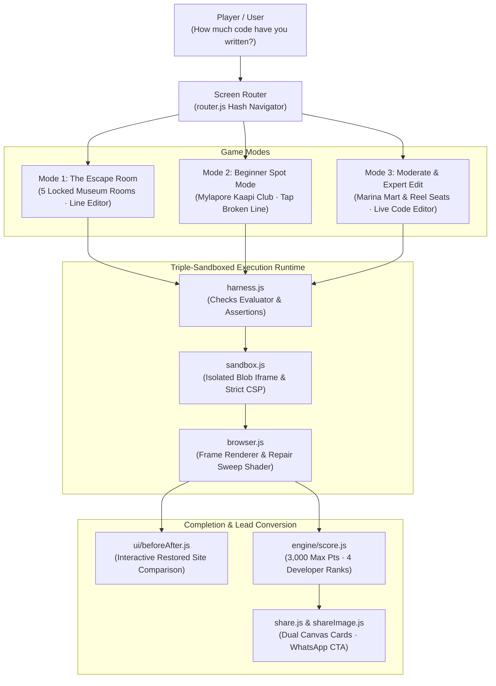

# The Broken Website — Interactive Web Debugging Game & Security Sandbox

> **Live Application:** [broken-website.vercel.app](https://broken-website.vercel.app/)  
> **Interactive Automated Demo:** [broken-website.vercel.app/?demo=1&puzzle=b2](https://broken-website.vercel.app/?demo=1&puzzle=b2)  
> **In-Browser Test Suite:** [broken-website.vercel.app/?test=1](https://broken-website.vercel.app/?test=1)  
> **Puzzle Lab Verification:** [broken-website.vercel.app/tools/puzzle-lab.html](https://broken-website.vercel.app/tools/puzzle-lab.html)  
> **Author:** [B Pradeep](https://github.com/Pradeep-B28) · [Portfolio](https://pradeep-b28.github.io/Pradeep-B28/)

---

## Overview

**The Broken Website** is an interactive, browser-based web debugging simulator and cybersecurity escape room created by **Wrench Wise**. It immerses players in real-world software engineering workflows: diagnosing client bug reports, inspecting source code, applying precision repairs across HTML, CSS, and JavaScript, and running automated behavioral test suites.

Engineered with **zero external frameworks, zero bundlers, and zero third-party runtime libraries**, the application runs entirely in the browser using native ES modules, strict Content Security Policy (CSP) sandboxed iframes, procedural Web Audio synthesis, and dynamic HTML5 canvas image generation.



---

## Architectural Highlights

| Feature | Technical Implementation |
| :--- | :--- |
| **Zero Runtime Dependencies** | 100% Vanilla ES6+ modules. No React, Vue, webpack, Vite, or npm production packages. Zero build or compilation step required. |
| **Double-Sandboxed Execution** | User-submitted code executes inside an isolated `<iframe>` with `sandbox="allow-scripts"` (strictly omitting `allow-same-origin`) backed by an inline Content Security Policy blocking unauthorized fetch, eval, and parent DOM tampering. |
| **Procedural Web Audio Engine** | Native browser `AudioContext` synthesizes clean chimes, mechanical keypad clicks, doors sliding, error thuds, and victory sweeps entirely via code oscillators—zero audio assets or MP3 network overhead. |
| **Dynamic 60 FPS Repair Sweep** | Solved puzzles render a cinematic repair sweep using CSS clip-path masks, transitioning the client site from its glitching broken state to its verified functional layout. |
| **Client-Side Image Synthesis** | Offscreen HTML5 `<canvas>` elements dynamically render branded achievement cards in both Instagram Story/WhatsApp Status (`1080×1920`) and LinkedIn Post (`1200×630`) dimensions for single-tap downloads. |
| **Autonomous Demo & Presenter Modes** | Automated autoplay engine (`?demo=1`) for screen recordings and reels; hotkey-enabled presenter mode (`?present=1`) for classroom lectures and workshop presentations. |

---

## Game Modes & Progression Matrix

The game dynamically guides players based on their prior programming experience:

| Prior Experience | Destination | Gameplay Mechanism | Target Skills |
| :--- | :--- | :--- | :--- |
| **Never coded** | **The Night Museum** *(Escape Room)* | 5 mystery rooms. Uncover hidden clues in DOM elements, apply targeted single-line edits, and crack passcodes on the digital keypad. | HTML tag hierarchy, attribute values, comments, and developer tools intuition. |
| **Little HTML / CSS** | **Beginner** *(Mylapore Kaapi Club)* | Spot mode: read customer complaint tickets and tap the exact broken line in the read-only code viewer (4 multiple-choice options). | Broken image paths, unclosed tags, inline style conflicts, CSS grid definitions, responsive viewport width. |
| **Built small projects** | **Moderate** *(Marina Mart)* | Edit mode: live multi-file editor (`index.html`, `styles.css`, `script.js`). Fix bugs and run real behavioral test assertions against the DOM. | Flexbox overflow, event listener binding, array mutations, checkout totals calculation, discount logic. |
| **Codes regularly** | **Expert** *(Reel Seats)* | Full developer mode: multi-component cinema booking system. Fix asynchronous seat race conditions, price tiers, and booking handlers. | Closures, event delegation, state synchronization, input sanitization, dynamic ticket modal rendering. |

---

## Security Architecture: Sandboxed Code Execution

Executing untrusted user-submitted code in the browser is safeguarded through a defense-in-depth security model:

1. **Isolated Iframe Sandbox:** Every client website is rendered inside a dynamically generated iframe using:
   ```html
   <iframe sandbox="allow-scripts"></iframe>
   ```
   Omitting `allow-same-origin` ensures the iframe cannot read localStorage, inspect parent cookies, access parent DOM nodes, or tamper with application state.
2. **Strict Content Security Policy (CSP):** The iframe payload injects an explicit CSP meta tag restricting network calls, script evaluations, and unauthorized resource origins:
   ```html
   <meta http-equiv="Content-Security-Policy" content="default-src 'self' data: blob: 'unsafe-inline'; connect-src 'none';">
   ```
3. **Execution Timeout Guards:** A 2,500ms watchdog timer automatically terminates run checks if user code contains infinite loops (`while(true)`) or synchronous recursion, surfacing a clean error in the integrated console drawer without locking the user's browser tab.

---

## Automated In-Browser Verification

The project includes an automated test harness validating content schema integrity, scoring mathematics, storage keys, and WhatsApp deep-link serialization:

### 1. In-Browser Self-Test Suite
Directly open the self-test harness in any modern browser:
```
https://broken-website.vercel.app/?test=1
```
Runs 10 automated test suites across all application subsystems:
- `a`: Content structure (4 sites, 4 levels, 15 puzzles, 5 rooms)
- `b`: Puzzles and rooms in the browser (60 page runs, 6 sandbox checks)
- `c`: Scoring & developer rank thresholds (3,000 max score)
- `c2`: Lock & timer math (answers, decoys, clock format)
- `d`: Progress management & unlock cascades
- `e`: Sales WhatsApp message generation & phone sanitization
- `f`: Social share text encoding & URL deep links
- `g`: Analytics payload validation (27 event schemas)
- `h`: Tone, copy, and formatting rules
- `i`: Storage schema & version constraints

### 2. Browser Puzzle Lab
Validates that every single puzzle and escape room passes its checks when solved, and fails when broken:
```
https://broken-website.vercel.app/tools/puzzle-lab.html
```

### 3. Node.js Content Schema Verification
Run the offline validator to test all puzzle files, checks, and alternative solutions:
```bash
node tools/verify-content.mjs
```
*Expected terminal output:* `RESULT: ALL PASS`.

---

## Local Development Setup

No package manager installation, compilation, or build tool is needed.

1. **Clone the repository:**
   ```bash
   git clone https://github.com/Pradeep-B28/Broken_Website.git
   cd Broken_Website
   ```

2. **Start a local static HTTP server:**
   ```bash
   # Using Python 3
   python -m http.server 8000

   # Or using Node.js
   npx serve .
   ```

3. **Open in browser:**
   ```
   http://localhost:8000/
   ```

> **Note:** Always open via an HTTP server rather than double-clicking `index.html`. Modern web browsers require HTTP origins to load ES modules and execute sandboxed blob iframes.

---

## Attribution & Educational Mission

Built with code by **[Wrench Wise](https://wrench-wise.com/)** as an interactive lead magnet and diagnostic experience for:
- **Certification Program in AI-Powered Full Stack Development**
- **Certification Program in AI-Powered Software Engineering & DSA**

Real developers spend the majority of their careers debugging, refactoring, and restoring systems rather than writing code from scratch. If you can fix these websites, you think like a developer.

---

## License

MIT License · Copyright © 2026 [B Pradeep](https://github.com/Pradeep-B28) & [Wrench Wise](https://wrench-wise.com/).
